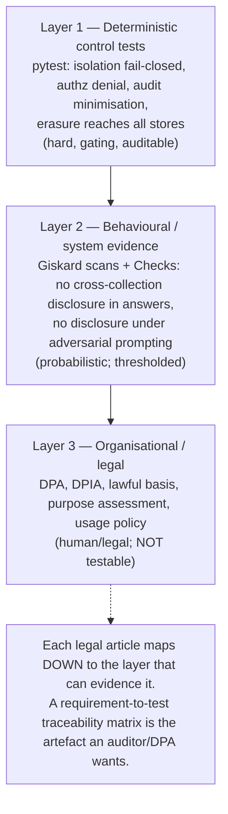

# Impact of EU Law on PrivateGPT — Requirements, Mitigations, and Compliance Evidence

**Document type:** Technical-legal impact analysis (GDPR, AI Act, NIS2, CRA)
**Companion documents:**
[`privacy-dfd-system-model.md`](./privacy-dfd-system-model.md) ·
[`linddun-elicitation-collection-audit.md`](./linddun-elicitation-collection-audit.md) ·
[`risk-prioritisation-collection-audit.md`](./risk-prioritisation-collection-audit.md) ·
[`tests-collection-audit.md`](./tests-collection-audit.md) ·
[`giskard-privacy-testing-evaluation.md`](./giskard-privacy-testing-evaluation.md)

> **⚠️ Not legal advice.** This is a *technical* mapping of EU legal obligations
> onto PrivateGPT's architecture, written by engineers to guide design and
> testing. Whether any obligation applies — and the resulting liability —
> depends on deployment specifics (who is controller vs processor, data
> categories, jurisdiction, sector). **Have a qualified lawyer / DPO validate any
> compliance claim before relying on it.** Legal dates and figures below were
> checked against public sources in this analysis but should be re-verified, as
> several instruments (notably the AI Act "Digital Omnibus") are still moving.

---

## Table of contents

1. [Who bears which obligation (the controller/processor/provider question)](#1-who-bears-which-obligation)
2. [Why PrivateGPT's architecture is legally load-bearing](#2-why-the-architecture-is-legally-load-bearing)
3. [GDPR — Regulation (EU) 2016/679](#3-gdpr)
4. [AI Act — Regulation (EU) 2024/1689](#4-ai-act)
5. [NIS2 — Directive (EU) 2022/2555](#5-nis2)
6. [CRA — Regulation (EU) 2024/2847](#6-cra)
7. [Cross-cutting requirements matrix](#7-cross-cutting-requirements-matrix)
8. [Can test coverage "prove" legal compliance?](#8-can-test-coverage-prove-legal-compliance)
9. [Compliance-evidence plan for developers and users](#9-compliance-evidence-plan)
10. [Assumptions and open questions](#10-assumptions-and-open-questions)

---

## 1. Who bears which obligation

Obligations attach to *roles*, and PrivateGPT's design makes the role allocation
unusual: it is an **open-source API layer that does not run models itself** and
is **self-hosted** by whoever deploys it. That matters legally.

```mermaid
flowchart LR
    DEV["Zylon / OSS maintainers<br/>(software provider)"]
    DEPLOYER["Organisation deploying PrivateGPT<br/>(the operator)"]
    SUBJECT["Data subjects<br/>(people in prompts/documents)"]
    MODELPROV["External model/parse providers<br/>(OpenAI-compatible, Docling, ...)"]

    DEV -->|ships software| DEPLOYER
    DEPLOYER -->|GDPR controller (usually)| SUBJECT
    DEPLOYER -->|GDPR controller -> processor| MODELPROV
    DEPLOYER -->|AI Act 'deployer'| MODELPROV
    MODELPROV -->|AI Act 'provider' of the model| DEPLOYER
```

| Role | Who, typically | Primary instruments |
|---|---|---|
| **GDPR controller** | The deploying organisation (decides purposes/means) | GDPR |
| **GDPR processor / sub-processor** | External model, embedding, parsing, storage providers (TB-INFER, TB-PARSE, TB-STORAGE) | GDPR Art. 28 |
| **AI Act "provider"** | Whoever places an AI *system* on the market under their name; the LLM provider for GPAI models | AI Act |
| **AI Act "deployer"** | The deploying organisation using the system | AI Act |
| **NIS2 essential/important entity** | The deploying organisation, *if* in a covered sector and size | NIS2 |
| **CRA "manufacturer"** | Whoever commercialises PrivateGPT as a "product with digital elements" (Zylon for the commercial distribution; pure OSS has a carve-out) | CRA |

**Key consequence:** most GDPR/NIS2/AI-Act-deployer duties fall on the
**operator**, but *the software must make those duties technically achievable*.
A deployer cannot honour an erasure request if the software cannot delete; cannot
prove collection isolation if the software cannot enforce it. The OSS
maintainers' main legal exposure is via the **CRA** (secure-by-design of the
product) and, for the bundled components, AI Act transparency.

---

## 2. Why the architecture is legally load-bearing

Every legal obligation below lands on a specific DFD element already modelled.
This table is the bridge between "law" and "code".

| Legal theme | DFD element (from the model) | Code anchor |
|---|---|---|
| Purpose limitation / access control between tenants | **TB-USER** (aspirational) | `vector_store_component.get_filters`; `collection_isolation.py` |
| Data minimisation in logs/telemetry | **DS-LOGS, DS-TRACES** | `semantic_search.py:186` (query at INFO); `observability/exporters.py` |
| International transfer / third-party processing | **TB-INFER, TB-PARSE, TB-STORAGE** | `openai.api_base`, `docling.api_base`, `s3.*` |
| Right to erasure | **DS-QDRANT, DS-INDEX** | `IngestService.delete`; `node_store_component.py:233-265` |
| Security of processing | **TB-NET** (auth/CORS), **TB-SANDBOX** | `server/utils/auth.py`; `bash_executor.py` |
| Accountability / audit | **DS-AUDIT** (proposed) | `components/audit/` |
| Secure-by-default configuration | Default posture (model §4) | `settings.yaml` |

---

## 3. GDPR

Regulation (EU) 2016/679. Fines (Art. 83): up to **€10M / 2%** of global annual
turnover (organisational breaches) or **€20M / 4%** (core principles, data-subject
rights, transfers), whichever is higher.

### Art. 5(1)(b)–(c) — Purpose limitation & data minimisation

- **Obligation:** personal data collected for specified purposes, not further
  processed incompatibly; limited to what is necessary.
- **PrivateGPT exposure:** **cross-collection retrieval** (threats
  T-DF03-Dd1/Dd2) lets data ingested for collection A surface in a query scoped
  to B — processing for a purpose the subject never consented to. The default
  **INFO query logging** (T-DF01-U1) stores query text with no minimisation.
- **Concrete example:** a hospital deploys PrivateGPT with one collection per
  department; a cross-collection leak surfaces psychiatric notes in a query by
  general-admin staff → unlawful further processing of Art. 9 special-category
  data.
- **Mitigation (implemented/available):** `vectorstore.strict_isolation` +
  `CollectionAuthorizer` (fail-closed `get_filters`); disable/guard the INFO
  query log; minimised audit (hash, not raw query) in `components/audit/`.
- **Financial example from case law:** data-minimisation / lawful-basis failures
  have drawn large fines; Google's **€50M** fine (CNIL, 2019) turned on
  transparency and legal basis for processing. Core-principle breaches sit in the
  4% tier.

### Art. 15 & 17 — Right of access and right to erasure

- **Obligation:** provide a copy of a subject's data; erase it on request
  ("right to be forgotten").
- **PrivateGPT exposure:** erasure must reach **every** store holding the data —
  Qdrant vectors + payload text (DS-QDRANT), index JSON (DS-INDEX), uploaded
  files (DS-FILES-LOCAL), and any audit/trace store. The model notes Qdrant has
  **no TTL** and deletion is API-driven only; if a document was also embedded
  into traces (DS-TRACES) or a temp S3 bucket (DS-S3-TEMP), those copies must be
  found too.
- **Concrete example:** a subject asks to be erased; the ingested PDF is deleted
  from Qdrant but a verbatim copy persists in `traces.jsonl` because observability
  was on → incomplete erasure.
- **Mitigation:** ensure `IngestService.delete` is wired for every store; keep
  observability off or content-capture disabled by default (it is); document a
  deletion runbook covering all DS-* in the model.
- **Financial example:** access/erasure failures are 4%-tier; multiple DPAs have
  fined organisations for failing to honour erasure within deadline.

### Art. 25 — Data protection by design and by default

- **Obligation:** implement appropriate measures *by design* and ensure that *by
  default* only necessary data is processed.
- **PrivateGPT exposure (sharp one):** the shipped defaults are **auth off, CORS
  open, query logging on**. "By default" the system is *not* data-protective —
  the deployer must actively harden it. This is precisely an Art. 25(2) concern.
- **Mitigation:** ship/operate the hardened profile (model scenario **S1/S2**):
  auth on, TLS, CORS restricted, strict isolation on, logging minimised. Make the
  secure configuration the documented default for any real deployment.
- **Why it matters:** Art. 25 is invoked alongside Art. 5/32 in many enforcement
  actions as the "you should have designed it safely" hook.

### Art. 28 — Processors and sub-processors

- **Obligation:** a controller may only use processors providing sufficient
  guarantees; needs a written contract (DPA); sub-processors need authorisation.
- **PrivateGPT exposure:** every third-party crossing — **TB-INFER** (LLM/embed),
  **TB-PARSE** (Docling), **TB-STORAGE** (S3/trace vendor), and request-driven
  tool egress (MCP/external DB, out of current scope but relevant) — is a
  processor relationship. The model documents these as organizational boundaries
  *when placed in the cloud* (model §9.3.1 topology axis).
- **Concrete example:** pointing `openai.api_base` at a hosted US LLM makes that
  vendor a sub-processor and triggers both Art. 28 (DPA) and Chapter V (transfer).
- **Mitigation:** prefer the self-hosted topology (model scenario **S1**,
  co-located models) to avoid the processor/transfer problem entirely; where
  cloud is used, keep an up-to-date processor register and DPAs.

### Art. 32 — Security of processing

- **Obligation:** appropriate technical/organisational security (incl.
  confidentiality, access control, encryption, resilience).
- **PrivateGPT exposure:** **TB-NET** default (auth off, plaintext bind, open
  CORS) is a direct Art. 32 weakness; the **code-execution sandbox** has no
  network isolation (TB-SANDBOX); cross-collection access is a confidentiality
  failure.
- **Mitigation:** auth + TLS + CORS restriction; strict isolation; treat the
  sandbox's lack of network isolation as a documented control gap.
- **Financial example:** Art. 32 security failures are frequent fine grounds;
  British Airways (~£20M, ICO, 2020) and many others turned on inadequate
  security measures.

### Chapter V (Art. 44–46) — International transfers

- **Obligation:** personal data may leave the EEA only with an adequacy decision,
  SCCs, or another safeguard.
- **PrivateGPT exposure:** any TB-INFER/TB-PARSE/TB-STORAGE endpoint physically
  outside the EEA is a transfer. The product's *self-hosted, local-first* design
  is a transfer-avoidance feature if used that way.
- **Financial example — the headline number:** **Meta — €1.2 billion** (Irish
  DPC, May 2023) for transferring EU user data to the US without adequate Art. 46
  safeguards. This is the **largest GDPR fine to date** and the canonical warning
  for the "just point it at a US cloud model" shortcut.
- **Mitigation:** keep models/stores in-region (scenario S1/S1′ with EU
  endpoints); document data residency per DFD destination.

> Note on case law currency: the Amazon **€746M** fine (Luxembourg, 2021), long
> cited as the second-largest, was **annulled on procedural grounds in 2026**;
> cite Meta €1.2B as the standing record and treat older "top fine" lists with
> care.

---

## 4. AI Act

Regulation (EU) 2024/1689. In force **1 Aug 2024**, phased:

| Date | What applies |
|---|---|
| 2 Feb 2025 | Prohibited practices (Art. 5) + AI literacy (Art. 4) |
| 2 Aug 2025 | GPAI model obligations + governance + penalties |
| 2 Aug 2026 | General application + **Art. 50 transparency** |
| 2 Dec 2027 | High-risk Annex III systems (deferred) |

Fines: up to **€35M / 7%** turnover (prohibited practices); €15M/3% (most other
breaches). *(A "Digital Omnibus" revision was provisional at time of writing —
re-verify.)*

### Art. 4 — AI literacy

- **Obligation:** providers/deployers ensure a sufficient level of AI literacy
  among staff operating AI systems.
- **PrivateGPT exposure:** a deployer standing up PrivateGPT must train operators
  on its limits (hallucination, the fact that retrieved context may be wrong,
  that logging/tracing capture content).
- **Mitigation:** operator documentation; this is largely organisational.

### Art. 5 — Prohibited practices

- **Obligation:** no social scoring, manipulative subliminal techniques, certain
  biometric categorisation, untargeted facial-image scraping, etc.
- **PrivateGPT exposure:** the *platform* is general-purpose, so prohibition risk
  arises from **how a deployer uses it** (e.g. building a social-scoring agent on
  the API). The audit-telemetry design (profiling querying users) must **not**
  drift into prohibited behavioural scoring.
- **Mitigation:** usage policy; keep audit telemetry strictly security-purpose
  and minimised (ties to the LINDDUN Non-compliance mitigations).

### Art. 50 — Transparency obligations

- **Obligation (from 2 Aug 2026):** users must be informed they are interacting
  with an AI system; certain AI-generated content must be marked.
- **PrivateGPT exposure:** a chat UI/API built on PrivateGPT must disclose its AI
  nature to end users; this is a deployer duty the software should make easy.
- **Mitigation:** surface an "AI assistant" disclosure in the UI/responses;
  document for API integrators.

### GPAI model obligations (Art. 53 ff.)

- **Obligation:** providers of general-purpose AI models keep technical
  documentation, a training-data summary, and a copyright policy.
- **PrivateGPT exposure:** **PrivateGPT does not provide the model** — it
  connects to one. The GPAI obligations fall on the *model* provider (the
  OpenAI-compatible endpoint). This is a genuine liability-reducing feature of
  the architecture, *but* the deployer should confirm its chosen model provider
  is GPAI-compliant.
- **Mitigation:** record the model provider and its AI-Act posture in the
  deployment's documentation.

### High-risk (Art. 6/Annex III) — conditional

- **Obligation:** if the deployment is a high-risk use case (e.g. recruitment,
  credit, essential services), risk management, logging, human oversight, and
  conformity assessment apply (from Dec 2027).
- **PrivateGPT exposure:** the *platform* is not inherently high-risk, but a RAG
  assistant over HR or medical collections could make a deployment high-risk.
  Here the **DS-AUDIT logging** design and the **collection-isolation** controls
  become directly relevant to the Art. 12 (logging) and Art. 14 (oversight)
  requirements.
- **Mitigation:** if high-risk, the audit trail (Option B, minimised) helps meet
  record-keeping; human-in-the-loop for consequential outputs.

---

## 5. NIS2

Directive (EU) 2022/2555. **Transposition deadline 17 Oct 2024** (a *directive* —
applies through national law, which is fragmented and in several states late).
Covers 18 sectors; distinguishes **essential** and **important** entities. Fines
(via national law): up to **€10M / 2%** turnover (essential) and €7M/1.4%
(important), plus possible management liability.

### Art. 21 — Cybersecurity risk-management measures

- **Obligation:** covered entities adopt risk-management measures — incident
  handling, access control, encryption, supply-chain security, vulnerability
  handling.
- **PrivateGPT exposure:** if the deployer is an essential/important entity (e.g.
  a hospital, bank, cloud provider) running PrivateGPT, the system falls within
  its NIS2 scope. The default posture (auth off, open CORS) and the sandbox's
  lack of network isolation are the obvious gaps; **supply-chain** security
  covers the third-party model/parse/store providers (the same TB-* crossings).
- **Mitigation:** hardened deployment (S1/S2); vendor assessment for TB-INFER/
  TB-PARSE/TB-STORAGE; patch management for PrivateGPT and its dependencies.

### Art. 23 — Incident reporting

- **Obligation:** report significant incidents — early warning within **24h**,
  notification within **72h**, final report within one month.
- **PrivateGPT exposure:** a cross-collection disclosure incident (or an audit-
  store breach) in a covered entity would trigger reporting timelines. The
  system must produce the evidence needed to assess and report — which is exactly
  what the **minimised audit trail** provides.
- **Mitigation:** the DS-AUDIT design, plus retained security logs, support
  detection and the reporting timeline; define an incident runbook.

---

## 6. CRA

Regulation (EU) 2024/2847. In force **10 Dec 2024**; Art. 14 reporting from
**11 Sep 2026**; full application incl. CE marking **11 Dec 2027**. Applies to
**"products with digital elements"** placed on the EU market. Fines up to
**€15M / 2.5%** turnover for essential-requirement breaches.

> **OSS nuance:** the CRA has a carve-out for open-source software developed/
> supplied *outside a commercial activity*. A pure community OSS project is
> largely out of scope; **Zylon commercialising PrivateGPT** (and any deployer
> selling a product built on it) is more likely a "manufacturer". This is the
> instrument most directly aimed at the *software maintainers*, not just the
> operator.

### Annex I — Essential cybersecurity requirements

- **Obligation:** secure-by-design and **secure-by-default**; no known
  exploitable vulnerabilities at release; minimise attack surface; protect
  confidentiality/integrity; data minimisation.
- **PrivateGPT exposure:** "secure by default" collides with the shipped defaults
  (auth off, CORS open, query logging on). The CRA essentially *requires* the
  hardened profile to be the default for a commercial product.
- **Mitigation:** flip the secure defaults for any commercially-placed
  distribution; ship `strict_isolation`-ready configuration; document the secure
  configuration baseline.

### Art. 13 — Vulnerability handling / SBOM

- **Obligation:** manufacturers identify and document vulnerabilities, provide a
  software bill of materials (SBOM), issue security updates.
- **PrivateGPT exposure:** PrivateGPT has a large dependency tree (llama-index,
  Qdrant client, Celery, Playwright, etc.); each is CRA-relevant supply chain.
- **Mitigation:** generate and maintain an SBOM (e.g. from `uv.lock` /
  `pyproject.toml`); dependency scanning in CI; a documented security-update
  process; a `SECURITY.md` (the repo already has one).

### Art. 14 — Reporting of actively exploited vulnerabilities (from 11 Sep 2026)

- **Obligation:** report actively exploited vulnerabilities and severe incidents
  to ENISA/CSIRT within tight deadlines (24h early warning).
- **Mitigation:** monitoring + an intake/triage process; this overlaps the NIS2
  Art. 23 runbook.

---

## 7. Cross-cutting requirements matrix

One technical control often satisfies several instruments — which is the key to
an efficient compliance-test strategy.

| Technical control (PrivateGPT) | GDPR | AI Act | NIS2 | CRA | DFD / threat | Test today |
|---|:--:|:--:|:--:|:--:|---|---|
| Collection isolation / authorisation | Art. 5, 25, 32 | high-risk logging | Art. 21 | Annex I | TB-USER, T-DF03-Dd1/Dd2 | `test_collection_isolation.py` ✅ |
| Fail-closed defaults (auth/TLS/CORS) | Art. 25, 32 | — | Art. 21 | Annex I (secure-by-default) | TB-NET | config/deployment |
| Log/telemetry minimisation | Art. 5(1)(c) | Art. 5 (no scoring) | — | Annex I (minimisation) | DS-LOGS, T-DF01-U1 | needs test |
| Minimised audit trail | Art. 5, 30 (records) | Art. 12 (high-risk logging) | Art. 23 (reporting) | Art. 14 | DS-AUDIT | `test_audit_recorder.py` ✅ |
| Erasure reaches all stores | Art. 17 | — | — | — | DS-QDRANT/INDEX/FILES/TRACES | needs test |
| Data residency / no transfer | Chapter V, Art. 28 | GPAI (provider) | Art. 21 (supply chain) | — | TB-INFER/PARSE/STORAGE | config/deployment |
| SBOM + vuln handling | — | — | Art. 21 | Art. 13/14 | dependency tree | CI tooling |
| AI transparency notice | — | Art. 50 | — | — | UI/API | needs test (UI) |

---

## 8. Can test coverage "prove" legal compliance?

**Short answer: no — but it is the strongest available *evidence*, and for some
obligations it is near-dispositive.** The honest distinction:

- **Law is not fully testable.** Many obligations are *organisational,
  contextual, or judgemental* — purpose compatibility, "appropriate" security,
  lawful basis, DPA existence, proportionality. No unit test decides whether a
  processing purpose is lawful.
- **But specific technical obligations are testable, and a test is auditable
  proof the control works.** "Collection B's data never surfaces in a B-scoped
  query", "the audit record stores a hash not the raw query", "an unauthorised
  collection is refused" — these are exactly the controls that satisfy GDPR
  Art. 5/25/32 and CRA Annex I, and they are already deterministic tests.

So the right mental model is a **three-layer compliance-evidence stack**, not
"100% coverage = compliant":



### What "legal test coverage" can realistically look like

- **Requirement-to-test traceability.** The deliverable is not a coverage
  percentage but a **matrix mapping each legal control to the test(s) that
  evidence it** (the §7 table, extended with a "Test ID" column). This is the
  artefact a DPA or CRA conformity assessor actually wants: "show me that your
  isolation control works" → point at `test_collection_isolation.py` and its CI
  run.
- **Control coverage, not line coverage.** Measure *which legal controls have a
  passing test*, not what fraction of code lines are executed. 100% line coverage
  proves nothing about purpose limitation; a passing fail-closed-isolation test
  proves the specific Art. 5/32 control.
- **Gating vs evidentiary.** Layer-1 deterministic tests **gate** every CI run
  (a regression is a compliance regression). Layer-2 Giskard behavioural tests are
  **evidentiary** (thresholded, scheduled) — they strengthen the case but cannot
  be a hard gate because they are probabilistic.
- **Negative/adversarial tests count double.** For security/isolation, a test
  that *demonstrates the leak when the control is off* (our non-strict baseline)
  and *its absence when on* (strict) is powerful evidence that the control is the
  thing doing the work.
- **Provenance.** Tests must be versioned with the code (they are, on this
  branch), run in CI with retained results (JUnit), and traceable to the threat
  model and these legal articles — which is the chain this doc set establishes.

### Honest limits

- A green suite proves the *tested* controls work on the *tested* scenarios. It
  does **not** prove the deployment is lawful (wrong config, missing DPA, unlawful
  purpose all pass every test).
- Behavioural tests sample; "no leak observed" ≠ "no leak possible".
- Compliance is continuous: tests must run against the *actual deployed
  configuration* (strict isolation on, EU endpoints), or they evidence a system
  nobody is running.

---

## 9. Compliance-evidence plan

A concrete, staged way for developers and operators to make the above real.

**For developers (OSS maintainers / Zylon — CRA + by-design):**

1. **Flip secure defaults** for any commercially-placed build (auth, TLS guidance,
   CORS, `strict_isolation`, logging minimisation) → GDPR Art. 25, CRA Annex I.
2. **Maintain an SBOM** from `uv.lock`/`pyproject.toml` and run dependency
   vulnerability scanning in CI → CRA Art. 13.
3. **Extend the deterministic test suite** to the untested controls in §7:
   log-minimisation test, erasure-reaches-all-stores test, (UI) AI-transparency
   test. Keep the requirement→test matrix in-repo.
4. **Keep `SECURITY.md` + a vulnerability-reporting/triage process** → CRA Art. 14,
   NIS2 Art. 23.
5. **Publish a "secure deployment baseline"** doc = scenario S1/S2 config.

**For operators (deployers — GDPR controller + AI-Act deployer + NIS2):**

1. **Deploy the hardened profile** (S1/S2): auth on, TLS, CORS restricted,
   `strict_isolation: true` + a real `CollectionAuthorizer`, observability off or
   content-capture disabled.
2. **Keep models/stores in-region** (self-hosted or EU endpoints) to avoid
   Chapter V transfer and reduce Art. 28 processor exposure.
3. **Run a DPIA** for the deployment (GDPR Art. 35) and record the
   controller/processor map (this doc's §1 is a starting template).
4. **Wire + retain the minimised audit trail** (Option B) for detection and
   NIS2/CRA incident reporting — kept strictly to the security purpose.
5. **Maintain organisational Layer-3 artefacts**: DPAs with each TB-* provider, a
   usage policy (AI Act Art. 5), AI-literacy training (Art. 4), an AI-transparency
   notice (Art. 50), and an incident runbook (NIS2 Art. 23 / CRA Art. 14).
6. **Run the test suite against the real deployed config** and retain results as
   evidence.

---

## 10. Assumptions and open questions

- **Role allocation is deployment-specific.** §1 assumes the common
  self-hosted-controller pattern; a SaaS reselling PrivateGPT shifts roles. A
  lawyer must confirm per deployment.
- **CRA OSS carve-out scope** for PrivateGPT specifically (community vs Zylon
  commercial) needs legal confirmation — it determines whether maintainers carry
  manufacturer duties.
- **High-risk classification** depends entirely on use case; most RAG assistants
  are not high-risk, but HR/medical/credit deployments may be.
- **NIS2 applicability** depends on the deployer's sector and size, and on the
  (fragmented) national transposition — check the specific Member State's law.
- **AI Act "Digital Omnibus"** was provisional at time of writing; dates/duties
  may shift — re-verify before relying.
- **Fines are illustrative.** Figures (Meta €1.2B; Google €50M; AI Act €35M/7%;
  CRA €15M/2.5%; NIS2 tiers) are public maxima/precedents, not predictions for any
  PrivateGPT deployment. The annulled Amazon €746M fine is flagged as no longer
  standing.
- **Testability boundary (§8)** is the central caveat: tests evidence *technical*
  controls; they cannot evidence lawful basis, purpose, or contracts.

---

*This analysis maps GDPR, AI Act, NIS2 and CRA obligations onto PrivateGPT's
modelled architecture and existing tests, shows where the software already helps
(collection isolation, minimised audit, local-first topology) and where it does
not (insecure defaults, log minimisation, erasure completeness), and argues that
test coverage is strong **evidence** — organised as a requirement→test
traceability matrix across a deterministic/behavioural/organisational stack —
rather than legal proof. It is engineering guidance, not legal advice.*
