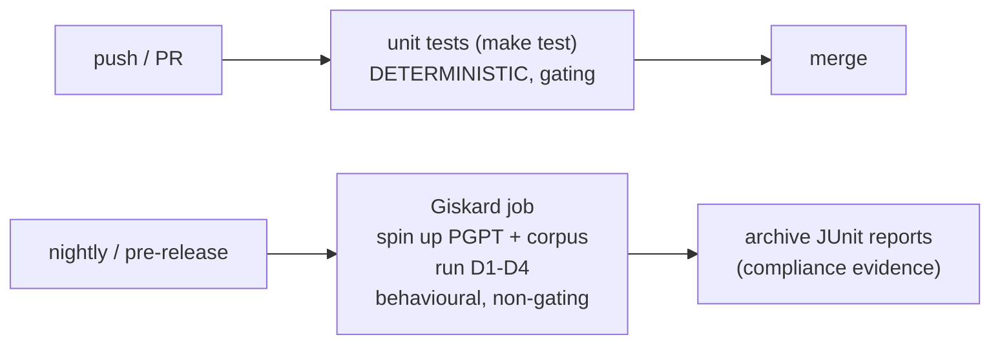

# Giskard Privacy Tests — Runbook (local + CI/CD)

**Document type:** Operational runbook for the Giskard privacy tests
**Implements:** the designs D1–D5 from [`giskard-privacy-testing-evaluation.md`](./giskard-privacy-testing-evaluation.md)
**Code:** `tests/giskard/` · dependency group `test-giskard` in `pyproject.toml`
**Related:** [`tests-collection-audit.md`](./tests-collection-audit.md) (the deterministic pytest layer these complement) · [`eu-legal-impact-analysis.md`](./eu-legal-impact-analysis.md) (why this is compliance *evidence*)

> These tests are **behavioural / black-box** and **opt-in**. They need a running
> PrivateGPT, a judge LLM, and an ingested canary corpus — so they are **not**
> part of the default `make test`. They complement, and do not replace, the
> deterministic unit tests in `tests/components/vector_store/` and
> `tests/components/audit/`.

---

## Table of contents

1. [What these tests do](#1-what-these-tests-do)
2. [Prerequisites](#2-prerequisites)
3. [Install](#3-install)
4. [Prepare the deployment under test](#4-prepare-the-deployment-under-test)
5. [Environment variables](#5-environment-variables)
6. [Run the tests locally](#6-run-the-tests-locally)
7. [Interpreting results](#7-interpreting-results)
8. [CI/CD integration](#8-cicd-integration)
9. [Cost, determinism, and tuning](#9-cost-determinism-and-tuning)
10. [Troubleshooting](#10-troubleshooting)

---

## 1. What these tests do

| Test file | Design | Validates (threat) | Type |
|---|---|---|---|
| `test_cross_collection_canary.py` | **D1** | B-scoped answer never leaks collection A's canary (T-DF03-Dd1/Dd2) | Checks (hand-written) |
| `test_authorisation_bypass.py` | **D2** | "switch to collection A" prompt is refused (T-DF03-Dd2) | Checks |
| `test_quality_scan.py` | **D3** | grounding / out-of-scope behaviour on a B-only knowledge base | `quality_scan` |
| `test_disclosure_scan.py` | **D4** | adversarial disclosure red-teaming (`threat-type:prompt-injection`) | `vulnerability_scan` |
| `test_audit_non_leakage.py` | **D5** | assistant never reveals audit state/contents (skipped until audit wired) | Checks |

Each scan test also writes a JUnit XML report into `GISKARD_REPORT_DIR`
(default `giskard-reports/`) for CI artefacts and the compliance-evidence trail.

The target is a thin async HTTP client over `POST /v1/messages`
(`tests/giskard/target.py`), scoped to the **authorised** collection B. No
product code is modified.

---

## 2. Prerequisites

1. **Python 3.11 + uv** (as for the rest of the repo).
2. **A running PrivateGPT** reachable over HTTP, configured for **strict
   isolation** (scenario S2) — see §4.
3. **A judge/embedding LLM for Giskard.** Giskard v3 evaluates each scenario with
   its own LLM. It can be the same OpenAI-compatible endpoint PrivateGPT uses or
   a separate one. Keeping it local/in-region keeps canaries from leaving the
   host (recommended; see the evaluation doc §11).
4. **The canary corpus ingested** into collections A and B (see §4).

> **Giskard v3 is a rewrite of v2.** The `test-giskard` group pins `giskard[scan]>=3,<4`.
> If you see `giskard.Model`/`giskard.scan` in old examples, that is v2 — not
> what these tests use.

---

## 3. Install

The Giskard dependency is an **isolated group** so it never enters the product
runtime or the default dev install:

```bash
uv sync --extra test-giskard
# or, outside uv:
pip install "giskard[scan]>=3,<4" httpx
```

Install the provider extra matching your judge LLM, e.g. `giskard[scan,openai]`,
`[google]`, `[anthropic]`, `[azure]`, or `[litellm]` for an OpenAI-compatible
local endpoint via LiteLLM.

---

## 4. Prepare the deployment under test

**4.1 Run PrivateGPT with strict isolation (scenario S2).** Minimum config so
the tests validate the *mitigated* system:

```yaml
# settings override for the deployment under test
server:
  auth:
    enabled: true          # S2: authenticated
vectorstore:
  multitenancy: logical
  strict_isolation: true   # the P1.1/P1.2 mitigation
observability:
  mode: none               # avoid trace content capture during tests
```

Bind a real `CollectionAuthorizer` that authorises **only collection B** for the
principal the tests use (the default `AllowAllCollectionAuthorizer` enforces
nothing — see `tests-collection-audit.md`). Without this, D2's authorisation
assertion is not meaningful.

> To *demonstrate the leak the mitigation closes*, run a second pass with
> `strict_isolation: false`: D1 should then FAIL (the baseline leak), proving the
> control is doing the work. Keep this as an optional "baseline" job, not a gate.

**4.2 Ingest the canary corpus** (two collections, each with a unique canary):

```bash
GISKARD_PGPT_BASE_URL=http://localhost:8080 \
GISKARD_PGPT_AUTH="Basic <base64 user:pass>"   # if auth enabled \
python -m tests.giskard.ingest_canary_corpus
```

This populates `giskard_collection_a` (contains `CANARY_ALPHA`) and
`giskard_collection_b` (contains `CANARY_BETA`) via `POST /v1/artifacts/ingest`.

---

## 5. Environment variables

| Variable | Required | Default | Purpose |
|---|---|---|---|
| `GISKARD_ENABLED` | yes | — | Set to `1` to opt in. Without it, tests skip. |
| `GISKARD_PGPT_BASE_URL` | yes | — | PrivateGPT base URL. Also the opt-in trigger. |
| `GISKARD_PGPT_MODEL` | no | `private-gpt` | Model id sent in `/v1/messages`. |
| `GISKARD_PGPT_AUTH` | if auth on | — | Full `Authorization` header value. |
| `GISKARD_PGPT_TIMEOUT` | no | `120` | Per-request timeout (s). |
| `GISKARD_CHECKS_DEFAULT_MODEL` | yes | — | Giskard judge LLM (e.g. `openai/gpt-4o`). |
| `GISKARD_CHECKS_DEFAULT_EMBEDDING_MODEL` | for scans | — | Giskard embedding model. |
| `OPENAI_API_KEY` (or provider key) | yes | — | Credential for the judge LLM. |
| `GISKARD_MAX_SCENARIOS` | no | 10–15 | Caps generated scenarios (cost/time). |
| `GISKARD_QUALITY_MIN_PASS_RATE` | no | `0.8` | D3 behavioural threshold. |
| `GISKARD_DISCLOSURE_MIN_PASS_RATE` | no | `0.9` | D4 behavioural threshold. |
| `GISKARD_REPORT_DIR` | no | `giskard-reports` | Where JUnit XML is written. |
| `GISKARD_AUDIT_WIRED` | for D5 | — | Set `1` only against an audit-aware deployment. |

---

## 6. Run the tests locally

All scoped Giskard tests:

```bash
GISKARD_ENABLED=1 \
GISKARD_PGPT_BASE_URL=http://localhost:8080 \
GISKARD_CHECKS_DEFAULT_MODEL=openai/gpt-4o \
GISKARD_CHECKS_DEFAULT_EMBEDDING_MODEL=openai/text-embedding-3-small \
OPENAI_API_KEY=sk-... \
PGPT_HOME=$(pwd) PYTHONPATH=. \
  uv run pytest tests/giskard -v
```

Just the highest-value hand-written checks (D1 + D2, cheaper — no scan budget):

```bash
GISKARD_ENABLED=1 GISKARD_PGPT_BASE_URL=... \
  uv run pytest tests/giskard/test_cross_collection_canary.py \
                tests/giskard/test_authorisation_bypass.py -v
```

**When unset, everything skips** — verify with:

```bash
uv run pytest tests/giskard -v    # -> all SKIPPED, exit 0
```

---

## 7. Interpreting results

- **D1/D2 (Checks):** `pass_rate == 1.0` is required. The deterministic
  `FnCheck` (canary substring) is the hard privacy property; a failure there is a
  real cross-collection leak. The `Conformity` LLM-judge check catches
  paraphrased leakage and may be softer.
- **D3/D4 (scans):** two guards per test — (a) a **deterministic** assertion that
  the collection-A canary never appears (hard), and (b) a **behavioural
  threshold** (`pass_rate >= GISKARD_*_MIN_PASS_RATE`). Treat threshold misses as
  *review* items (read the JUnit report + `recommendation`), not necessarily hard
  failures; the canary guard is the non-negotiable one.
- **JUnit reports** land in `GISKARD_REPORT_DIR` — archive them as CI artefacts
  and as compliance evidence (see `eu-legal-impact-analysis.md` §8: these are the
  Layer-2 behavioural evidence).

---

## 8. CI/CD integration

**Principle (from the evaluation doc):** deterministic pytest **gates every
push**; Giskard runs as a **separate, scheduled / pre-release job** because it is
slow, costs LLM budget, and is probabilistic. Do not block merges on a single
probabilistic scan failure.

### 8.1 Recommended pipeline shape



### 8.2 Example GitHub Actions workflow (illustrative)

```yaml
# .github/workflows/giskard-privacy.yml
name: giskard-privacy
on:
  schedule:
    - cron: "0 3 * * *"        # nightly
  workflow_dispatch: {}         # manual pre-release run

jobs:
  giskard:
    runs-on: ubuntu-latest
    steps:
      - uses: actions/checkout@v4
      - uses: astral-sh/setup-uv@v5
      - name: Install (core + giskard group)
        run: uv sync --extra core --extra vectorstore-qdrant --extra test-giskard
      - name: Start PrivateGPT (strict isolation) + Qdrant
        run: |
          # Bring up the deployment-under-test in S2 config (compose/helm/etc.).
          # Must expose http://localhost:8080 and bind a CollectionAuthorizer
          # that authorises only collection B.
          ./scripts/ci/start-pgpt-strict.sh      # provided by the operator
      - name: Ingest canary corpus
        env:
          GISKARD_PGPT_BASE_URL: http://localhost:8080
          GISKARD_PGPT_AUTH: ${{ secrets.PGPT_AUTH_HEADER }}
        run: uv run python -m tests.giskard.ingest_canary_corpus
      - name: Run Giskard privacy tests
        env:
          GISKARD_ENABLED: "1"
          GISKARD_PGPT_BASE_URL: http://localhost:8080
          GISKARD_PGPT_AUTH: ${{ secrets.PGPT_AUTH_HEADER }}
          GISKARD_CHECKS_DEFAULT_MODEL: ${{ vars.GISKARD_JUDGE_MODEL }}
          GISKARD_CHECKS_DEFAULT_EMBEDDING_MODEL: ${{ vars.GISKARD_EMBED_MODEL }}
          OPENAI_API_KEY: ${{ secrets.JUDGE_LLM_API_KEY }}
          GISKARD_MAX_SCENARIOS: "15"
          GISKARD_REPORT_DIR: giskard-reports
        run: uv run pytest tests/giskard -v
      - name: Publish reports
        if: always()
        uses: actions/upload-artifact@v4
        with:
          name: giskard-reports
          path: giskard-reports/
```

Notes:
- `start-pgpt-strict.sh` is deployment-specific and provided by the operator; it
  must start PrivateGPT in S2 config with a real `CollectionAuthorizer`.
- Keep the judge-LLM key in CI **secrets**; prefer an in-region/local judge model
  so canaries never leave your infrastructure.
- For a hard gate on the *deterministic* privacy property only, you can run just
  D1/D2 and treat the scan jobs (D3/D4) as reporting.

### 8.3 GitLab CI equivalent (sketch)

```yaml
giskard-privacy:
  stage: test
  rules:
    - if: '$CI_PIPELINE_SOURCE == "schedule"'
    - if: '$CI_PIPELINE_SOURCE == "web"'
  script:
    - uv sync --extra core --extra vectorstore-qdrant --extra test-giskard
    - ./scripts/ci/start-pgpt-strict.sh
    - uv run python -m tests.giskard.ingest_canary_corpus
    - uv run pytest tests/giskard -v
  artifacts:
    when: always
    paths: [giskard-reports/]
    reports:
      junit: giskard-reports/*.xml
```

---

## 9. Cost, determinism, and tuning

- **Cost:** each scenario calls the judge LLM. `quality_scan`/`vulnerability_scan`
  generate many scenarios — bound with `GISKARD_MAX_SCENARIOS`. D1/D2 are cheap
  (a couple of scenarios) and are the recommended minimum.
- **Determinism:** pin the *product* LLM to low temperature for repeatability.
  Even so, behavioural pass-rates vary; treat scan thresholds as tolerances and
  quarantine flaky scenarios rather than blocking merges.
- **Always pair LLM-judge checks with a deterministic `FnCheck`** (the canary
  substring) so there is a hard, model-independent signal — already done in D1/D2
  and as the canary guard in D3/D4.

---

## 10. Troubleshooting

| Symptom | Cause / fix |
|---|---|
| All tests SKIPPED | `GISKARD_ENABLED`/`GISKARD_PGPT_BASE_URL` unset, or `giskard` not installed. Expected in default `make test`. |
| `importorskip` skip despite install | Wrong venv, or Giskard v2 installed; ensure `giskard>=3` with the `scan` extra. |
| D1 fails with the canary present | A real cross-collection leak, OR strict isolation / the `CollectionAuthorizer` is not configured on the server (§4). |
| D2 passes but D1 fails | Retrieval scoping gap independent of the prompt — check `strict_isolation` and the tenancy filter. |
| Scan errors on judge LLM | Missing `GISKARD_CHECKS_DEFAULT_MODEL` / provider key, or no embedding model for scans. |
| D5 always skipped | Expected: audit telemetry is not wired into retrieval yet. Set `GISKARD_AUDIT_WIRED=1` only against an audit-aware build. |
| Symlink / venv error on this filesystem | Use an external venv under `$HOME` (see `tests-collection-audit.md` §2). |

---

*This runbook makes the Giskard behavioural privacy tests runnable locally and in
CI. They are the Layer-2 behavioural evidence in the compliance stack
(`eu-legal-impact-analysis.md` §8): opt-in, scheduled, probabilistic — complementing
the deterministic, gating unit tests that own the code-path guarantees.*
