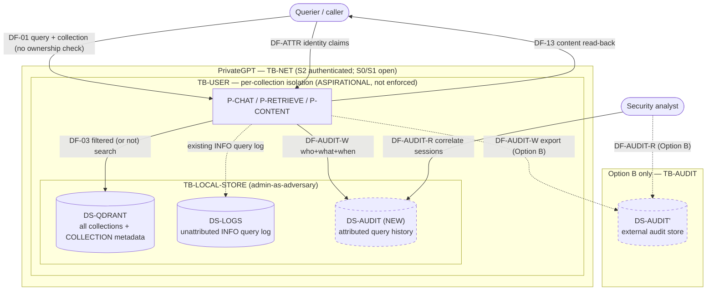

# LINDDUN PRO Elicitation — Cross-Collection Retrieval and Audit Telemetry

**Document type:** Scoped LINDDUN PRO threat elicitation
**Companion documents:**
[`scoped-analysis-collection-audit.md`](./scoped-analysis-collection-audit.md) (scope & model extension) ·
[`privacy-dfd-system-model.md`](./privacy-dfd-system-model.md) (system model & DFDs) ·
[`use-cases.md`](./use-cases.md) (use cases)
**Method:** LINDDUN PRO — per data-flow elicitation across each trust-boundary crossing, against the seven threat categories.
**Scope:** As fixed in the scoped analysis — (1) cross-collection retrieval and (2) audit telemetry introduced to mitigate it. Inference, tools, MCP, web, code execution, DB tools, and prompt injection are out of scope unless needed to explain a collection or audit flow.

---

## Table of contents

1. [Method and conventions](#1-method-and-conventions)
2. [Scoped DFD under analysis](#2-scoped-dfd-under-analysis)
3. [Threat-category applicability overview](#3-threat-category-applicability-overview)
4. [Per-flow elicitation](#4-per-flow-elicitation)
   - [DF-01 — request in (query + collection selector)](#df-01--request-in-query--collection-selector)
   - [DF-03 — retrieval (embed + Qdrant filtered search)](#df-03--retrieval-embed--qdrant-filtered-search)
   - [DF-13 — content read-back](#df-13--content-read-back)
   - [DF-AUDIT-W — audit write](#df-audit-w--audit-write)
   - [DF-AUDIT-R — audit investigation read](#df-audit-r--audit-investigation-read)
   - [DF-ATTR — attribution capture](#df-attr--attribution-capture)
5. [Option A vs Option B — how the audit architecture changes the threats](#5-option-a-vs-option-b--how-the-audit-architecture-changes-the-threats)
6. [Threat register (summary)](#6-threat-register-summary)
7. [Mitigation directions](#7-mitigation-directions)
8. [Assumptions and residual questions](#8-assumptions-and-residual-questions)

---

## 1. Method and conventions

LINDDUN PRO elicits privacy threats **per data flow, at each trust-boundary
crossing**, against seven categories:

| Code | Category | One-line meaning |
|---|---|---|
| **L** | Linking | Associating data items / actions as belonging to the same subject. |
| **I** | Identifying | Reducing a subject's anonymity; tying data to a real identity. |
| **Nr** | Non-repudiation | Subject cannot deny an action (undesirable for privacy). |
| **D** | Detecting | Inferring something from mere observation of the system/data. |
| **Dd** | Data Disclosure | Excessive/unauthorized exposure of (personal) data. |
| **U** | Unawareness | Subject is unaware / cannot intervene in processing of their data. |
| **Nc** | Non-compliance | Processing violates policy/legal obligations (purpose, retention, rights). |

Conventions:

- **Threat IDs** are `T-<FLOW>-<CATEGORY><n>` (e.g. `T-DF03-Dd1`).
- Each threat cites **source evidence** (`path:line`) where it is grounded in code.
- **Scenario basis** (model §9.3): the target is **S2 (multi-tenant)**; **S0/S1**
  is the as-is baseline that demonstrates the gaps. "Authorised only for another
  collection" presupposes per-collection authorisation, which the model records
  as the *aspirational* boundary **TB-USER** (no code binds caller identity to a
  collection).
- **Data subjects** in scope: (a) *collection data subjects* — people whose
  personal data is in ingested documents; (b) *the querying user* — whose query
  behaviour becomes audit data.

---

## 2. Scoped DFD under analysis

In-scope flows: **DF-01, DF-03, DF-13** (existing); **DF-AUDIT-W, DF-AUDIT-R,
DF-ATTR** (new, from scoped analysis §7). In-scope boundaries: **TB-USER**
(primary), **TB-NET**, **TB-LOCAL-STORE**, **TB-AUDIT** (Option B).

---

## 3. Threat-category applicability overview

Legend: ● primary focus · ○ relevant · – not a focus for this flow in scope.

| Flow | L | I | Nr | D | Dd | U | Nc |
|---|:--:|:--:|:--:|:--:|:--:|:--:|:--:|
| DF-01 request in | ○ | ○ | – | – | ○ | ● | ○ |
| DF-03 retrieval | ● | ○ | – | ● | ● | ○ | ● |
| DF-13 content read | ○ | ○ | – | ○ | ● | ○ | ● |
| DF-AUDIT-W audit write | ● | ● | ● | ○ | ● | ● | ● |
| DF-AUDIT-R audit read | ● | ● | ○ | ● | ● | ○ | ● |
| DF-ATTR attribution | ○ | ● | ● | – | ○ | ● | ○ |

The two halves of the scope show a deliberate **mirror**: the retrieval flows
(DF-01/03/13) concentrate on **Data Disclosure / Linking / Detecting** of
*collection* data; the audit flows (DF-AUDIT-*/ATTR) concentrate on **Linking /
Identifying / Non-repudiation / Unawareness** of *the querying user*. Mitigating
the first intensifies the second — the core trade-off.

---

## 4. Per-flow elicitation

### DF-01 — request in (query + collection selector)

- **Crossing:** `EE-CLIENT → P-CHAT` across **TB-NET**. Carries the query text and the caller-supplied `collection` (`chat/extensions/context_filter.py:22-26`).
- **Data:** query (potential personal data), `collection` name. **Subject:** querying user + any people named in the query.

| ID | Cat | Threat | Evidence / basis |
|---|---|---|---|
| T-DF01-U1 | U | The querying user is unaware their query text is written to logs at INFO by default (condenser path), independent of any observability setting. | `semantic_search.py:186`; `settings.yaml condense_strategy: condenser` |
| T-DF01-Dd1 | Dd | Under S0 the endpoint is unauthenticated and CORS is open, so query content can be submitted/observed without access control. | `server/utils/auth.py`; `settings.yaml server.auth/cors` |
| T-DF01-Nc1 | Nc | `collection` is a free, request-supplied string with **no ownership check** — the request can assert authorisation it does not have (purpose/authorisation gap). | `context_filter.py:22-26` |
| T-DF01-L1 | L | Repeated requests carrying the same (future) attribution + collection selector allow linking the user's queries into a profile (realised downstream at DF-AUDIT-W). | scoped §7 |
| T-DF01-I1 | I | If auth forwards an identity header (S1+), the query becomes tied to an identifiable caller at the boundary. | `launcher.py:_build_principal`; `server/principal.py` |

### DF-03 — retrieval (embed + Qdrant filtered search)

- **Crossing:** `P-RETRIEVE → DS-QDRANT` (and the embed hop to EE-EMBED, boundary only) **inside TB-LOCAL-STORE**, governed by the **TB-USER** isolation that does not exist. **This is the primary flow for issue 1.**
- **Data:** query vector; returned chunks (collection data, personal data). **Subject:** collection data subjects.

| ID | Cat | Threat | Evidence / basis |
|---|---|---|---|
| T-DF03-Dd1 | Dd | **Cross-collection disclosure.** Isolation is a single metadata filter added only when `logical_multitenancy and collection`; if `multitenancy == "collection"` the logical filter is skipped, or if `collection` is empty, the search runs unscoped and returns another collection's chunks. | `vector_store_component.py:98-111`; `qdrant_factory.py:62-90` |
| T-DF03-Dd2 | Dd | **Filter is not authorisation.** Even when applied, the filter trusts the request's `collection` value; a caller naming collection B retrieves B's data with no entitlement check. | `vector_store_component.py:101-105`; `context_filter.py:22-26` |
| T-DF03-L1 | L | Retrieved chunks from a mis-scoped query let an attacker link data across collections that should be siloed (e.g. correlate a person across tenant A and tenant B corpora). | derived from T-DF03-Dd1/2 |
| T-DF03-D1 | D | **Probing by observation.** Even without seeing content, result counts / scores / latency for crafted queries can reveal *whether* another collection contains matching data (membership inference on a siloed corpus). | retrieval returns scores (`primitives` example); `retrieval.py` |
| T-DF03-I1 | I | A returned chunk from another collection may directly identify a data subject who is otherwise siloed. | content-agnostic store (`metadata_helper`) |
| T-DF03-Nc1 | Nc | Cross-collection retrieval breaches purpose limitation and (multi-tenant) data-separation obligations; no technical control enforces the boundary (TB-USER aspirational). | model §9.5 TB-USER |
| T-DF03-U1 | U | Collection data subjects are unaware their ingested data can surface in a different collection's query. | derived |

### DF-13 — content read-back

- **Crossing:** `P-CONTENT → EE-CLIENT` across **TB-NET**, scoped by the same `ContextFilter` (UC-3). Bulk/full-document read.
- **Data:** full document content + metadata. **Subject:** collection data subjects.

| ID | Cat | Threat | Evidence / basis |
|---|---|---|---|
| T-DF13-Dd1 | Dd | Same filter-as-access-control weakness as DF-03, but higher impact: `/artifacts/content` returns **whole documents**, so a cross-collection gap discloses complete source files, not just chunks. | `server/content/content_router.py`; `context_filter.py` |
| T-DF13-L1 | L | Full-document read-back across collections enables richer linking than chunk retrieval. | derived |
| T-DF13-Nc1 | Nc | Bulk export of another collection's documents violates data-separation / purpose limitation. | derived |
| T-DF13-D1 | D | Enumeration: `/artifacts/list` + content lets a prober detect which artifacts exist in a collection they should not see. | `ingest_router.py list_ingested`; UC-2 |

### DF-AUDIT-W — audit write

- **Crossing:** `P-RETRIEVE/P-CHAT → P-AUDIT → DS-AUDIT` (new). Inside **TB-LOCAL-STORE** (Option A) or across **TB-AUDIT** (Option B). **Primary flow for issue 2.**
- **Data:** caller identity, `collection`, query (or hash), result refs, anomaly flag. **Subject:** the querying user. This flow *creates* a new body of personal data as the cost of mitigating issue 1.

| ID | Cat | Threat | Evidence / basis |
|---|---|---|---|
| T-DFAW-L1 | L | The audit record *is* a linkage mechanism: it correlates a user's queries across sessions into a behavioural profile. The more effective the probing detection, the stronger the linking. | scoped §8.2 |
| T-DFAW-I1 | I | Attribution (required to investigate probing) ties query behaviour to a real identity; stronger than the current unattributed log. | scoped §7 DF-ATTR |
| T-DFAW-Nr1 | Nr | The trail is non-repudiation by design: a legitimate user can no longer deny sensitive queries (e.g. health/legal interest), a privacy harm even when security-useful. | scoped §8.2 |
| T-DFAW-Dd1 | Dd | A new store of sensitive behavioural data (queries can contain personal data) with its own access/breach surface. If queries are logged verbatim rather than hashed, disclosure impact is maximal. | scoped §7 DS-AUDIT |
| T-DFAW-U1 | U | Users are typically unaware their queries are retained and correlated for security; no notice/consent path exists. | scoped §8.2 |
| T-DFAW-Nc1 | Nc | Purpose limitation (security ≠ analytics), retention limits, and data-subject rights now apply to the audit store; none are implemented. | scoped §8.2 |
| T-DFAW-D1 | D | Existence/length of a user's audit entries can itself reveal whether they were flagged as a prober. | scoped §8.2 |
| T-DFAW-Nc2 | Nc | **(Option B)** Export across TB-AUDIT to a separate operator adds a processor/sub-processor relationship requiring a DPA and disclosure. | scoped §8.3 |

### DF-AUDIT-R — audit investigation read

- **Crossing:** `P-AUDIT-INV (analyst) → DS-AUDIT` (new). UC-B.
- **Data:** correlated query history per user/session. **Subject:** the querying user.

| ID | Cat | Threat | Evidence / basis |
|---|---|---|---|
| T-DFAR-L1 | L | Investigation *is* cross-session correlation; the read step materialises the behavioural profile. | scoped §7 UC-B |
| T-DFAR-Dd1 | Dd | Analyst access to raw queries exposes personal data of innocent users swept into an investigation. | scoped §8.3 |
| T-DFAR-I1 | I | Correlating sessions can re-identify a user who used nominally separate sessions. | derived |
| T-DFAR-Nc1 | Nc | Over-broad analyst access / absent access controls on the audit store breach least-privilege and purpose limitation. | scoped §8.3 |
| T-DFAR-D1 | D | Query patterns in the audit store reveal sensitive interests of users never involved in probing. | derived |
| T-DFAR-L2 | L | **(cross-tenant)** If the audit store is not itself tenant-partitioned, an analyst for tenant A sees tenant B's query history — the audit system becomes a *new* cross-collection disclosure vector. | scoped §7 "TB-USER gains a second meaning" |

### DF-ATTR — attribution capture

- **Crossing:** `TB-NET (Principal) → P-AUDIT` (new). Supplies the identity that turns a query log into an attributed audit record.
- **Data:** caller identity claims. **Subject:** the querying user.

| ID | Cat | Threat | Evidence / basis |
|---|---|---|---|
| T-DFAT-I1 | I | Capturing and persisting the caller's identity for every retrieval is the step that makes the user identifiable in the audit trail. | `server/principal.py`; `launcher.py:_build_principal` |
| T-DFAT-U1 | U | Identity is captured from forwarded headers the user may not know are retained for security purposes. | `settings.yaml principal.forwarded_headers` |
| T-DFAT-Nr1 | Nr | Durable attribution removes deniability (feeds T-DFAW-Nr1). | derived |
| T-DFAT-Nc1 | Nc | Under S0 there is no reliable identity, so meaningful audit *presupposes* S1+ auth — coupling issue 2 to an access-control change and raising lawful-basis questions for the new processing. | scoped §10 |

---

## 5. Option A vs Option B — how the audit architecture changes the threats

The same audit flows produce a different threat profile depending on where the
audit data lives (scoped §6/§8.3). Summary of the *deltas* that matter for
LINDDUN:

| Threat area | Option A (internal, inside TB-LOCAL-STORE) | Option B (separate consumer, across TB-AUDIT) |
|---|---|---|
| **Dd in transit** | No new network crossing → smaller transit surface. | Adds TB-AUDIT crossing → new transit/breach surface (T-DFAW-Nc2). |
| **L / I concentration** | Audit + collection content co-located → trivially correlated; linkage concentrated in one operator. | Can enforce that the audit app sees refs/hashes not content → minimisation by construction; linkage separated. |
| **Nc purpose limitation** | Scope-creep risk: same operator reuses audit data for analytics; hard to prove limitation. | Distinct controller/processor, retention, access → purpose limitation enforceable. |
| **D / insider (admin-as-adversary)** | TB-LOCAL-STORE admin sees both content and audit. | PrivateGPT admin need not access the audit store; but a new trusted operator appears. |
| **Nr / integrity** | App compromise can tamper with its own trail. | External append-only store → stronger tamper-evidence. |
| **Cross-tenant audit leak (T-DFAR-L2)** | Must be solved inside the app's store. | Must be solved in the external store; either way the audit store needs its own tenant partitioning. |

**Reading.** Option A minimises *in-transit* disclosure; Option B is generally
preferable for *purpose limitation, minimisation, and separation of duties* —
provided the export is minimised (hashes/refs, not raw queries) and TB-AUDIT is
controlled. The worst choice is the implicit one analysed in scoped §8.4:
repurposing diagnostics tracing or the default INFO query log as the audit
trail, which violates purpose limitation and (for logs) fans out to
broadly-accessible aggregators.

---

## 6. Threat register (summary)

| ID | Flow | Cat | Severity (qual.) | Note |
|---|---|---|---|---|
| T-DF03-Dd1 | DF-03 | Dd | **High** | Cross-collection disclosure via missing/mis-set tenancy filter — the central issue-1 threat. |
| T-DF03-Dd2 | DF-03 | Dd | **High** | Filter is not authorisation; any caller names any collection. |
| T-DF13-Dd1 | DF-13 | Dd | **High** | Whole-document cross-collection read-back. |
| T-DF03-L1 | DF-03 | L | High | Cross-collection linking of a subject. |
| T-DF03-D1 | DF-03 | D | Med | Membership inference by score/latency without content. |
| T-DF03-Nc1 | DF-03 | Nc | High | No technical enforcement of collection separation (TB-USER aspirational). |
| T-DF01-U1 | DF-01 | U | Med | Default-on INFO logging of query text. |
| T-DF01-Nc1 | DF-01 | Nc | High | Unverified collection authorisation at the boundary. |
| T-DFAW-L1 | DF-AUDIT-W | L | **High** | Audit creates a cross-session behavioural profile (mitigation→privacy cost). |
| T-DFAW-I1 | DF-AUDIT-W | I | High | Attribution ties behaviour to identity. |
| T-DFAW-Nr1 | DF-AUDIT-W | Nr | Med | Loss of deniability for legitimate users. |
| T-DFAW-Dd1 | DF-AUDIT-W | Dd | High | New sensitive store; verbatim queries worsen it. |
| T-DFAW-U1 | DF-AUDIT-W | U | High | No notice/consent for security correlation. |
| T-DFAW-Nc1 | DF-AUDIT-W | Nc | High | Purpose/retention/rights unaddressed. |
| T-DFAW-D1 | DF-AUDIT-W | D | Med | Flagged-status inferable from the store. |
| T-DFAR-L2 | DF-AUDIT-R | L | **High** | Audit store itself a cross-tenant disclosure vector if not partitioned. |
| T-DFAR-Dd1 | DF-AUDIT-R | Dd | High | Analyst sees innocent users' queries. |
| T-DFAT-I1 | DF-ATTR | I | High | Attribution capture = identifiability. |
| T-DFAT-Nc1 | DF-ATTR | Nc | Med | Audit presupposes S1+ auth; lawful basis for new processing. |

*(Severity is qualitative and provisional; it orders mitigation attention, not a
formal risk score.)*

---

## 7. Mitigation directions

Grouped by the two issues; these are *directions*, to be detailed and tested
separately (not implemented in this document).

**Issue 1 — cross-collection retrieval (close the TB-USER gap):**

1. **Bind caller identity to authorised collections.** Introduce an
   authorisation check (caller → allowed collections) *before* retrieval, rather
   than trusting the request's `collection` string (addresses T-DF03-Dd2,
   T-DF01-Nc1). This is the structural fix for the aspirational TB-USER boundary.
2. **Make tenancy filtering unconditional and fail-closed.** Ensure a tenancy
   filter is always applied for every multitenancy mode, and that an empty/absent
   `collection` denies rather than runs unscoped (addresses T-DF03-Dd1). Covers
   both `logical` and `collection` modes.
3. **Minimise observable side-channels** (score/latency normalisation) to blunt
   membership inference (T-DF03-D1).
4. **Collection-isolation test** (the planned test): assert that a request
   authorised for B never returns A's chunks/documents under any multitenancy
   mode — a direct check on T-DF03-Dd1/Dd2 and T-DF13-Dd1.

**Issue 2 — audit telemetry (bound the new personal data):**

5. **Data minimisation by construction.** Store hashes/tokens of queries + the
   collection + attribution + anomaly flag, not raw query text (addresses
   T-DFAW-Dd1, and reduces L/I).
6. **Purpose limitation + retention policy** on DS-AUDIT, separate from content,
   with documented purpose = probing detection only (T-DFAW-Nc1, T-DFAR-Nc1).
7. **Tenant-partition the audit store** so analysts see only their tenant's
   records (addresses T-DFAR-L2 — the audit system must not become a new
   cross-collection vector).
8. **Transparency.** Disclose to data subjects that queries are retained and
   correlated for security; provide a basis and, where applicable, rights
   (T-DFAW-U1, T-DFAT-U1).
9. **Prefer a governed Option B** (minimised export, controlled TB-AUDIT,
   append-only) over an internal co-located store, and **never** repurpose the
   diagnostics tracing or the default INFO query log as the audit trail (scoped
   §8.4; addresses the purpose-limitation and log-fan-out hazards).
10. **Least-privilege analyst access** and access logging on DS-AUDIT itself
    (T-DFAR-Dd1, T-DFAR-Nc1).

**The trade-off, made explicit:** mitigations 1–4 reduce issue-1 threats but
*require* attribution/correlation (DF-ATTR, DF-AUDIT-*) that create issue-2
threats; mitigations 5–10 bound that cost. The residual decision — how much
audit fidelity to accept for how much detection capability — is a
privacy/security balance to be recorded as a conscious design choice, not left
implicit.

---

## 8. Assumptions and residual questions

- **TB-USER is aspirational.** The entire issue-1 analysis assumes the intended
  S2 target; today no code enforces per-collection authorisation
  (`vector_store_component.py:98-111`; model §9.5). The threats are therefore
  "as-designed gaps", confirmed by code, not runtime exploits.
- **Physical multitenancy path unverified.** Whether `multitenancy == "collection"`
  maps distinct collections to distinct physical Qdrant collections (and thus
  isolates without the logical filter) needs runtime confirmation
  (`qdrant_factory.py:62-90`).
- **Audit telemetry does not exist.** All DF-AUDIT-*/ATTR threats concern a
  *proposed* feature (scoped §5/§7); they are design-time threats guiding how (or
  whether) to build it.
- **Attribution requires auth.** Meaningful audit presupposes at least S1 (auth
  on); under S0 there is no reliable identity (T-DFAT-Nc1).
- **Query = personal data (assumed).** Treated as potentially personal because
  the system is content-agnostic; holds even if only the query (not collection
  content) is stored.
- **Prompt injection excluded.** Not analysed here; if testing shows untrusted
  document content can cause cross-collection access or disclose audit data, a
  follow-up elicitation on that vector is warranted (scoped §1).
- **Severity is provisional.** Qualitative ordering only; a formal risk
  assessment (likelihood × impact per deployment) is a separate step.

---

*This elicitation operationalises the scoped analysis into per-flow LINDDUN PRO
threats with source-grounded evidence, analyses the audit architecture both
ways, and proposes mitigation directions. The next deliverables are a formal
risk prioritisation and the collection-isolation test that validates
T-DF03-Dd1/Dd2 and T-DF13-Dd1.*
