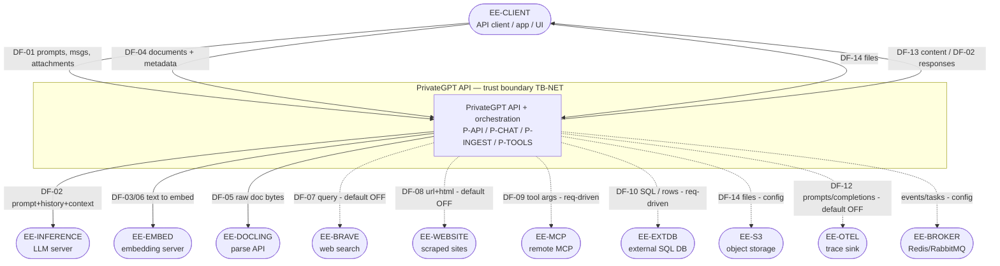
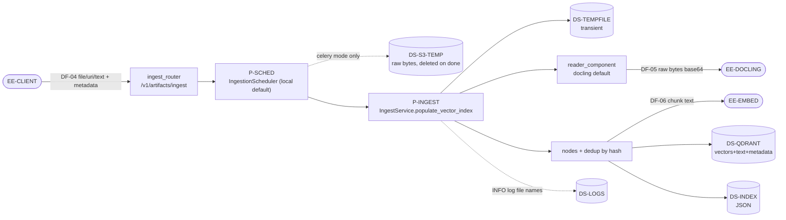
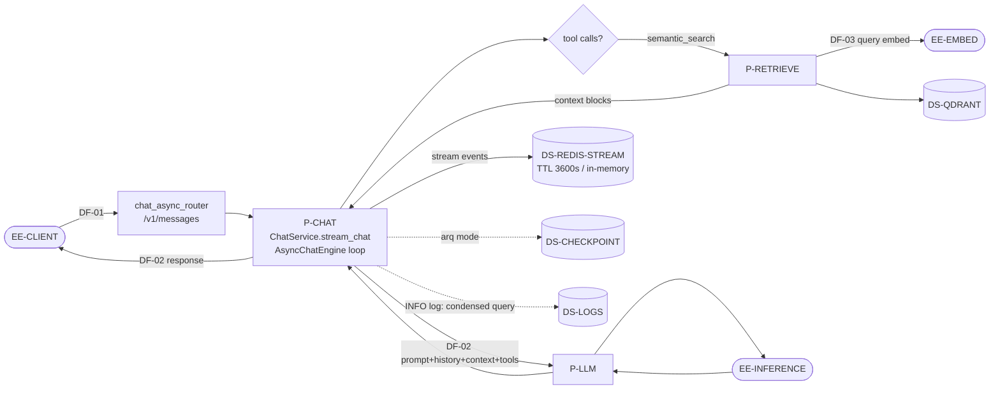
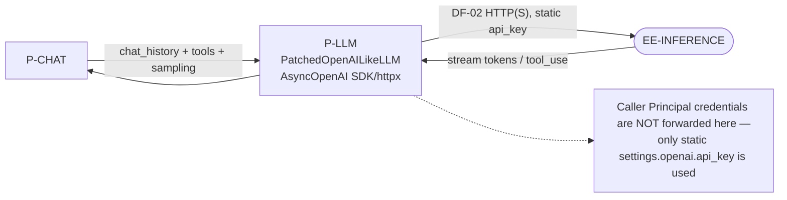
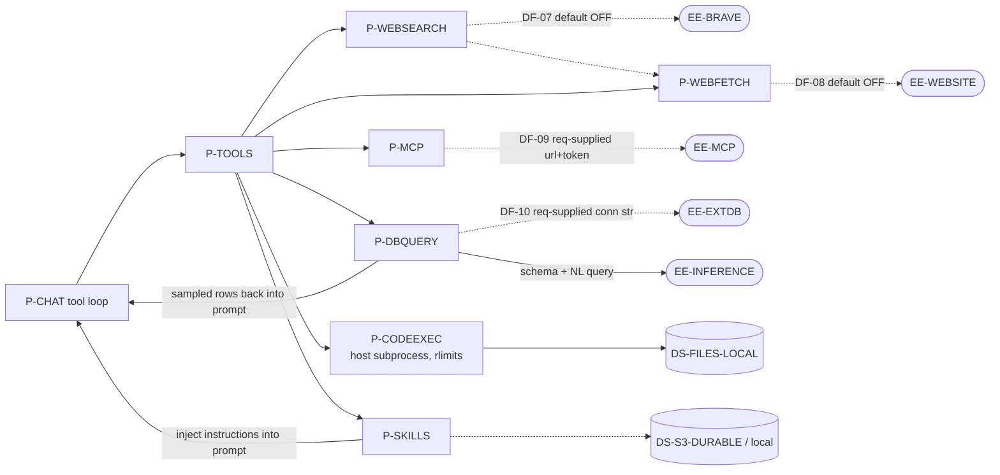
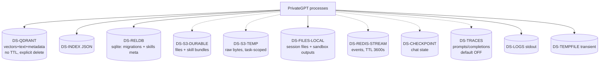
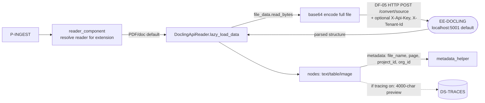
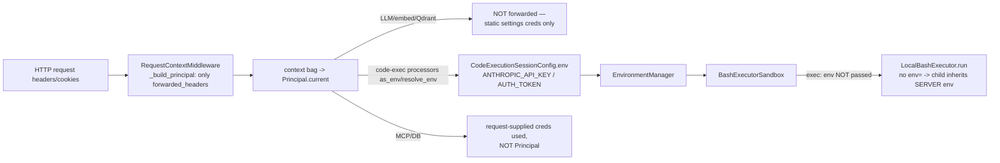
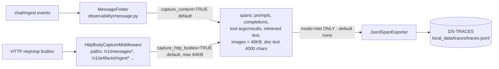
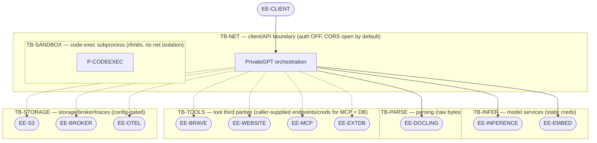

# PrivateGPT — System Model for LINDDUN PRO Privacy Threat Analysis

**Document type:** System model (Data Flow Diagrams and supporting inventory)
**Target repository:** `zylon-ai/private-gpt` (local working copy)
**Methodology:** LINDDUN PRO DFD notation
**Scope of this document:** System modelling only. No LINDDUN threat elicitation is performed here. This document produces the most accurate possible model of the system to serve as the input to a subsequent LINDDUN PRO analysis.
**Analysis basis:** Static source-code analysis, configuration files, API router definitions, dependency injection wiring, and application entry points.

---

## Table of contents

1. [Executive summary](#1-executive-summary)
2. [System overview](#2-system-overview)
3. [Methodology and conventions](#3-methodology-and-conventions)
4. [Default security and privacy posture](#4-default-security-and-privacy-posture)
5. [Component inventory (structured)](#5-component-inventory-structured)
6. [Level 0 — Context DFD](#6-level-0--context-dfd)
7. [Level 1 DFDs](#7-level-1-dfds)
8. [Level 2 DFDs — privacy-sensitive processing](#8-level-2-dfds--privacy-sensitive-processing)
9. [Trust boundaries](#9-trust-boundaries)
10. [Data flow catalogue (privacy attributes)](#10-data-flow-catalogue-privacy-attributes)
11. [Data-at-rest and retention](#11-data-at-rest-and-retention)
12. [Traceability table](#12-traceability-table-dfd-element--source-evidence)
13. [Assumptions, unresolved questions, and runtime-verification items](#13-assumptions-unresolved-questions-and-runtime-verification-items)

---

## 1. Executive summary

PrivateGPT is an **API layer** that turns local or remote OpenAI-compatible models into a production AI application backend. It deliberately **does not run models itself**; it orchestrates external inference, embedding, document-parsing, web-search, and tool services, and persists derived artifacts (vector embeddings, chunk text, metadata, uploaded files, skills).

From a privacy standpoint the system is **content-agnostic**: it processes whatever prompts, documents, filenames, database rows, and tool arguments its callers provide. Consequently, nearly every data flow *may* carry personal or sensitive data, and the privacy risk is dominated by **where data egresses** and **what is persisted or logged**.

Key structural findings that shape the model:

- **The orchestrator is a thin trust layer.** Authentication is **disabled by default** and CORS is **wide open by default**, so the client ↔ API boundary is, out of the box, an open boundary.
- **Core egress is unconditional in a working deployment.** Prompts and message history go to an external **inference server**; chunk/query text goes to an external **embedding server**; raw document bytes go to a **document-parsing API** (Docling). Whether these are same-host sidecars or third-party cloud endpoints is a deployment choice.
- **Several high-reach flows are caller-driven, not operator-configured.** MCP tool servers and external SQL databases are specified **per request** — the caller supplies both the endpoint and the credentials, and query results re-enter the model prompt.
- **A rich set of optional egress and logging surfaces is disabled by default** (web search, web fetch, OpenTelemetry trace capture, Celery/S3 workers). When enabled, the trace sink captures full prompts, completions, retrieved context, and document previews.
- **Code execution runs as a local host subprocess** with resource limits but **no network isolation**; the `internet_enabled` flag is advisory only for the bundled local provider.

Every element in this model is backed by a source file and line reference. Configuration-dependent and unverified items are explicitly flagged.

---

## 2. System overview

```text
Your app / agent / workflow / UI
              |
        PrivateGPT API        <-- the subject of this model
              |
OpenAI-compatible inference server (Ollama, llama.cpp, vLLM, ...)
```

PrivateGPT exposes an HTTP API (FastAPI) and an optional bundled static UI at `/ui`. The main capability groups are:

| Capability | API surface | Primary internal process |
|---|---|---|
| Chat / messages (streaming, tools, RAG) | `/v1/messages`, `/v1/messages/async` | Chat orchestration + async chat engine |
| Document ingestion | `/v1/artifacts/ingest`, `/ingest/async`, `/delete` | Ingestion pipeline + scheduler |
| Artifact content retrieval | `/v1/artifacts/content`, `/chunked-content` | Content service |
| Embeddings | `/v1/embeddings` | Embedding client |
| Tools (search, fetch, DB query, tabular, code exec, skills) | `/v1/tools/*` and in-chat tool loop | Tool framework |
| Files (session filesystem) | `/v1/files*` | Files API |
| Models / health / primitives / completion | `/v1/models`, `/health`, `/v1/primitives/*`, `/v1/complete` | Supporting services |

Application assembly:

- Entry point: `private_gpt/main.py` → `create_app(get_global_injector())` (`private_gpt/launcher.py:124`).
- Dependency injection via the `injector` library; a global/loop-scoped injector holds all singleton components (`private_gpt/di.py`).
- Per-request context: `RequestContextMiddleware` resets a context bag, builds a `Principal` from configured forwarded headers/cookies, and attaches the injector to the request (`private_gpt/launcher.py:60-123`).
- Routers are included for chat, async chat, completion, models, embeddings, ingest, convert, content, primitives, tools, skills, files, and health (`private_gpt/launcher.py:160-174`).

---

## 3. Methodology and conventions

This model was produced by:

1. Reading the application entry points, launcher, DI wiring, and settings schema.
2. Reading every API router to establish entry points, request/response shapes, and authentication context.
3. Tracing data flows across modules by following actual call sites — never inferring a flow from an import or a component name alone.
4. Investigating external libraries (OpenAI SDK usage, Docling API client, Playwright scraper, SQLAlchemy engines) where they materially affect data processing.
5. Distinguishing implemented behaviour from configuration-dependent or unwired behaviour.

**Status labels used throughout:**

| Label | Meaning |
|---|---|
| `implemented-default-on` | Code path exists and is active under shipped defaults. |
| `implemented-config-gated` | Code path exists but is only active when a setting is enabled or a request supplies the trigger. |
| `present-not-wired` | A setting or symbol exists but no active consumer was found in the traced code. |
| `unverified` | Could not be confirmed from static analysis alone. |

**Evidence citations** are given as `path:line` relative to the repository root. The main package is `private_gpt/`.

**Privacy attribute vocabulary** (recorded per data flow where applicable): source, destination, data categories, possible personal data, data subjects, processing purpose, transmission protocol, authentication/authorization context, encryption and trust-boundary crossings, persistence/retention implications, and whether data may reach third parties.

---

## 4. Default security and privacy posture

The shipped `settings.yaml` establishes the default posture. Note that several environment-variable-driven defaults in `settings.yaml` **differ from the Pydantic schema defaults** in `private_gpt/settings/settings.py`; this model uses the `settings.yaml` values as the effective default.

| Area | Default | Evidence | Privacy relevance |
|---|---|---|---|
| Authentication | **Disabled** (allow-all) | `settings.yaml` `server.auth.enabled: false`; `server/utils/auth.py` | Open client boundary |
| CORS | **Open** (`allow_origins:["*"]`, `allow_methods:["*"]`) | `settings.yaml` `server.cors` | Any origin may call the API |
| Bundled UI | **Enabled** at `/ui` | `settings.yaml` `server.ui.enabled: true`; `launcher.py:176-247` | Browser access surface |
| Observability / tracing | **Off** (`mode: none`) | `settings.yaml` `observability.mode: none`; `initialize.py:107-112` | Content capture inactive until enabled |
| Trace content capture | `capture_content: true`, `capture_http_bodies: true` (effective **only when tracing on**) | `settings.yaml`; `settings.py` `ObservabilitySettings` | When enabled, prompts/completions persisted |
| Web search | **Off** (`enabled: false`, `provider: mock`) | `settings.yaml` `web_search` | No Brave egress by default |
| Web fetch | **Off** (`enabled: false`) | `settings.yaml` `web_fetch` | No site scraping by default |
| Schedulers | **Local / in-process** (ingestion, chat, tools) | `settings.yaml` `scheduler.*.mode: local` | No broker/S3 egress by default |
| Stream broker | **Memory** | `settings.yaml` `stream.broker: memory` | Stream state ephemeral, in-process |
| S3 object storage | **Inactive** (`endpoint_url` empty) | `settings.yaml` `s3` | Local filesystem used instead |
| Relational DB | **SQLite** (no `provider` set in YAML → schema default `sqlite`) | `settings/settings.py` `DatabaseSettings.provider` | Local file, skills metadata only |
| Vector store | **Qdrant, embedded on-disk** (`qdrant.url` empty, `path: local_data/qdrant`) | `settings.yaml` `qdrant`; `vector_store/qdrant_client_builder.py:76-96` | Local by default |
| Code execution | **Enabled**, `provider: local`, `internet_enabled: false` | `settings.yaml` `code_execution` | Host subprocess, no net isolation |
| Hugging Face | `trust_remote_code: true` | `settings.yaml` `huggingface` | Can execute downloaded model code |
| Principal forwarded headers | `authorization, anthropic-beta` | `settings.yaml` `principal.forwarded_headers` (schema default differs: `authorization, x-api-key`) | Determines captured credentials |

---

## 5. Component inventory (structured)

The following YAML is the normative inventory. Diagrams in later sections reference these IDs.

```yaml
# ============================================================================
# PrivateGPT (zylon-ai/private-gpt) — LINDDUN PRO DFD inventory
# Evidence paths are relative to repo root: private_gpt/...
# status: implemented-default-on | implemented-config-gated | present-not-wired | unverified
# ============================================================================

metadata:
  system: PrivateGPT API layer (orchestrator over external model/parse/search services)
  product_role: "Does NOT run models. Connects to OpenAI-compatible inference servers."
  evidence_root: "private_gpt/"
  analysis_type: system-model-only

# ----------------------------------------------------------------------------
external_entities:
  - id: EE-CLIENT
    name: API client / app / agent / UI
    description: >
      Any caller of the HTTP API (developer app, Claude Desktop, n8n, bundled /ui).
      Supplies prompts, documents, tool definitions, MCP server configs, DB
      connection strings, and optionally credentials.
    evidence: [launcher.py:160, server/chat/chat_router.py:20]
    status: implemented-default-on

  - id: EE-INFERENCE
    name: External OpenAI-compatible inference server (LLM)
    description: Receives system prompt, full message history, retrieved RAG context, tool definitions, sampling params.
    trust: third-party / outside-boundary
    default_endpoint: "https://api.openai.com/v1 (OPENAI_API_BASE)"
    evidence:
      - components/custom/openai.py:62
      - components/llm/factories/completions/openailike.py:46-48
      - components/engines/chat/async_chat_engine.py:1127
    status: implemented-default-on

  - id: EE-EMBED
    name: External OpenAI-compatible embedding server
    description: Receives chunk text (ingestion) and query text (retrieval) to embed.
    default_endpoint: "openai.embedding_api_base or openai.api_base"
    evidence:
      - components/embedding/factories/openailike.py:27
      - components/embedding/embedding_component.py:36-40
    status: implemented-default-on

  - id: EE-QDRANT-REMOTE
    name: Remote Qdrant vector DB (optional)
    description: Only when qdrant.url is set; otherwise embedded on-disk.
    evidence: [components/vector_store/qdrant_client_builder.py:76-96]
    status: implemented-config-gated

  - id: EE-DOCLING
    name: Docling document-parsing API
    description: Default PDF/doc parse path. Receives RAW document bytes (base64) over HTTP POST.
    default_endpoint: "http://localhost:5001"
    evidence:
      - components/readers/docling/docling_api_reader.py:150
      - components/readers/docling/api_clients.py:313-343
      - components/readers/docling/api_clients.py:376-418
    status: implemented-config-gated

  - id: EE-BRAVE
    name: Brave Search API
    default_endpoint: "https://api.search.brave.com/res/v1/web/search"
    evidence: [components/web/web_search/providers/brave.py:18-19, components/web/web_search/providers/brave.py:113-131]
    status: implemented-config-gated

  - id: EE-WEBSITE
    name: Arbitrary websites (web_fetch + web_search scraping)
    description: Headless Chromium (Playwright) fetches model-supplied URLs.
    evidence:
      - components/web/scraper/scrape_script.py:72-98
      - components/web/scraper/local.py
      - components/tools/builders/web_fetch_builder.py:52-66
    status: implemented-config-gated

  - id: EE-MCP
    name: Remote MCP server(s)
    description: Endpoint + credentials supplied PER REQUEST. Receives LLM-generated tool arguments.
    evidence:
      - server/chat/chat_models.py:34-37
      - server/mcp/mcp_service.py:290-311
      - server/mcp/_runtime.py:218-252
    status: implemented-config-gated

  - id: EE-EXTDB
    name: External SQL database (database_query / tabular tools)
    description: Postgres/MySQL/MSSQL/DB2. Connection string supplied PER REQUEST. Rows flow back into prompt.
    evidence:
      - server/utils/artifact_input.py:168-215
      - components/database/connection_factory.py:21-35
      - components/tabular/database_query_generator.py:947-988
    status: implemented-config-gated

  - id: EE-S3
    name: Object storage (S3-compatible)
    description: Durable + temporary buckets. Inactive unless configured.
    evidence: [components/storage/object_storage.py:180]
    status: implemented-config-gated

  - id: EE-HF
    name: Hugging Face Hub
    description: Tokenizer/model downloads; trust_remote_code=true. NLTK packages also downloaded at init.
    evidence: [initialize.py:58-101]
    status: implemented-config-gated

  - id: EE-OTEL
    name: OpenTelemetry exporter / trace sink
    description: JSONL file sink by default; console; OTLP if registered.
    evidence: [observability/exporters.py:63-120, observability/exporters.py:166-171]
    status: implemented-config-gated

  - id: EE-BROKER
    name: Redis / RabbitMQ (broker + stream + checkpoint)
    evidence: [components/streaming/stream/registry.py:26-33]
    status: implemented-config-gated

# ----------------------------------------------------------------------------
processes:
  - id: P-API
    name: FastAPI app + RequestContextMiddleware
    evidence: [launcher.py:60-123, launcher.py:160-174]
    status: implemented-default-on
  - id: P-AUTH
    name: Authentication dependency (allow-all by default)
    evidence: [server/utils/auth.py]
    status: implemented-default-on
  - id: P-CHAT
    name: Chat / RAG orchestration (async engine)
    evidence:
      - server/chat_async/chat_async_router.py:143
      - server/chat_async/chat_async_service.py:28
      - server/chat/chat_facade.py:28
      - server/chat/chat_service.py:218-225
      - components/engines/chat/async_chat_engine.py:1127
    status: implemented-default-on
  - id: P-RETRIEVE
    name: Semantic retrieval (RAG, tool-driven)
    evidence:
      - components/tools/builders/semantic_search_builder.py:218
      - components/workflows/retrieval/retrieval.py:144
    status: implemented-default-on
  - id: P-LLM
    name: LLM client (PatchedOpenAILikeLLM over AsyncOpenAI SDK/httpx)
    evidence: [components/custom/openailike.py:42, components/custom/openai.py:62]
    status: implemented-default-on
  - id: P-EMBED
    name: Embedding client (OpenAILikeEmbedding)
    evidence: [components/embedding/factories/openailike.py:27]
    status: implemented-default-on
  - id: P-INGEST
    name: Ingestion pipeline
    evidence:
      - server/ingest/ingest_service.py:65
      - artifact_index/vector_artifact_index.py:111
      - components/ingest/ingest_component.py:66
      - components/readers/reader_component.py:54-61
    status: implemented-default-on
  - id: P-SCHED
    name: Ingestion/chat/tool scheduler (local default; Celery/ARQ optional)
    evidence: [components/ingestion/ingestion_scheduler.py:153-268, components/ingestion/ingestion_scheduler.py:443-512]
    status: implemented-config-gated
  - id: P-TOOLS
    name: Tool framework (build + invoke)
    evidence: [components/tools/tool_names.py:33-64, components/tools/tool_factories.py:44-241, server/tools/tool_service.py:33-83]
    status: implemented-default-on
  - id: P-CODEEXEC
    name: Code execution / sandbox (local provider, host subprocess, rlimits)
    evidence: [components/code_execution/bash_executor.py:20-36, components/code_execution/bash_executor.py:87-106, components/sandbox/local.py:53-70]
    status: implemented-default-on
  - id: P-MCP
    name: MCP client runtime (HTTP/SSE/stdio)
    evidence: [server/mcp/_runtime.py:218-252, server/mcp/mcp_service.py:290-311]
    status: implemented-config-gated
  - id: P-WEBSEARCH
    name: Web search service + processors
    evidence: [components/web/web_search/web_search_service.py:121-135]
    status: implemented-config-gated
  - id: P-WEBFETCH
    name: Web scraper service (Playwright/Chromium)
    evidence: [components/web/web_scraper_service.py:51-105, components/web/scraper/runner.py:97-192]
    status: implemented-config-gated
  - id: P-DBQUERY
    name: Database query + tabular analysis
    evidence: [components/tabular/database_query_generator.py:529, components/tabular/database_query_generator.py:947-988, components/tabular/pandasai_sandbox.py:284-361]
    status: implemented-config-gated
  - id: P-FILES
    name: Files API (session filesystem; local or S3)
    evidence: [server/files/files_router.py, server/files/file_service.py:70-91]
    status: implemented-default-on
  - id: P-SKILLS
    name: Skill management (store bundles, inject instructions into prompt)
    evidence: [components/skills/services/skill_service.py:52-57, components/tools/builders/skill_management_builder.py:65-68]
    status: implemented-config-gated
  - id: P-CONTENT
    name: Artifact content retrieval (/content, /chunked-content)
    evidence: [server/content/content_router.py]
    status: implemented-default-on
  - id: P-OBS
    name: Observability / tracing pipeline
    evidence: [observability/message.py:108-159, observability/http.py:139-190, observability/tracing.py:316-333]
    status: implemented-config-gated
  - id: P-MIGRATE
    name: Schema migrations (schema_migrations + skills tables)
    evidence: [components/persistence/persistence_component.py:76-103, components/skills/migrations.py:7-61]
    status: implemented-default-on

# ----------------------------------------------------------------------------
data_stores:
  - id: DS-QDRANT
    name: Qdrant vector store (embedded on-disk by default)
    location: "local_data/qdrant/ (or remote qdrant.url)"
    contents: [embedding_vectors, chunk_text, table_content, doc_metadata]
    retention: no TTL; explicit deletion only
    deletion_path: [artifact_index VectorArtifactIndex.delete, components/node_store/node_store_component.py:233-265]
    evidence: [components/vector_store/qdrant_factory.py:46-92, components/ingest/metadata_helper.py:7-21]
    sensitivity: high
    status: implemented-default-on
  - id: DS-INDEX
    name: Index store (SimpleIndexStore JSON)
    location: "local_data/private_gpt/<collection>/*.json"
    contents: [index_structs]
    evidence: [components/node_store/node_store_component.py:28-37, components/ingest/ingest_component.py:273]
    sensitivity: medium
    status: implemented-default-on
  - id: DS-RELDB
    name: Relational DB (SQLite default; Postgres optional)
    location: "local_data/private_gpt/skills/backend-main.db"
    contents: [schema_migrations, skills, skill_versions]
    note: "No chat/document content tables observed."
    evidence: [components/sqlite/sqlite_client.py:21-23, components/skills/migrations.py:7-61]
    sensitivity: low-medium
    status: implemented-default-on
  - id: DS-S3-DURABLE
    name: S3 durable bucket
    location: "s3://zylon-storage (default name)"
    contents: [skill_bundles, session/Files-API files]
    evidence: [server/files/file_service.py:86-91, components/skills/services/skill_service.py:52-57]
    sensitivity: high
    status: implemented-config-gated
  - id: DS-S3-TEMP
    name: S3 temporary bucket
    location: "s3://zylon-temporary (default name)"
    contents: [raw uploaded document bytes during Celery ingestion]
    retention: deleted on task completion; retry relies on external S3 lifecycle (unverified)
    evidence: [components/ingestion/ingestion_scheduler.py:443-461, celery/tasks/ingestion/extraction_tasks.py:296-309]
    sensitivity: high
    status: implemented-config-gated
  - id: DS-FILES-LOCAL
    name: Local session filesystem / object storage
    location: "local_data/private_gpt/storage, .../code_execution, .../volumes/{sessions,skills}"
    contents: [uploaded files, sandbox outputs, skill bundles]
    evidence: [server/files/file_service.py:82-89]
    sensitivity: high
    status: implemented-default-on
  - id: DS-REDIS-STREAM
    name: Redis Streams (chat events + status)
    retention: "stream_expiration default 3600s (TTL)"
    contents: [streamed chat events: deltas, tool calls, results]
    evidence: [components/streaming/stream/registry.py:26-33]
    sensitivity: high
    status: implemented-config-gated
  - id: DS-CHECKPOINT
    name: Chat checkpoint store (in-memory local / Redis ARQ)
    contents: [chat request + message history for resumable turns]
    evidence: [arq/chat/iteration_state.py, components/.../checkpoint_store.py:171]
    sensitivity: high
    status: implemented-config-gated
  - id: DS-TRACES
    name: Trace sink (JSONL file)
    location: "local_data/traces/traces.jsonl (rotated 50MB x5)"
    contents: [prompts, completions, tool args/results, retrieved text, parsed-doc preview, http bodies]
    evidence: [observability/exporters.py:63-120]
    sensitivity: very-high
    status: implemented-config-gated
  - id: DS-TEMPFILE
    name: OS temp files (ingestion)
    retention: deleted after use
    evidence: [server/ingest/ingest_service.py:122-152]
    sensitivity: high (transient)
    status: implemented-default-on
  - id: DS-LOGS
    name: Application logs (stdout)
    contents:
      - "INFO: full user query during condensation"
      - "INFO: ingested file names"
      - "DEBUG only: full prompts/messages/completions"
    evidence: [components/workflows/retrieval/semantic_search.py:186, components/llm/prompt_styles/prompt_style_base.py:126]
    sensitivity: medium-high
    status: implemented-default-on
  - id: DS-NLTK
    name: NLTK data cache / HF model cache
    location: "PGPT_HOME/models/nltk_cache, models/cache"
    contents: [tokenizers, taggers, corpora, model weights]
    evidence: [initialize.py:58-101, paths.py:13-14]
    sensitivity: none
    status: implemented-default-on

# ----------------------------------------------------------------------------
trust_boundaries:
  - id: TB-NET
    type: physical/network
    name: Client <-> PrivateGPT API boundary
    notes: "Auth disabled by default; CORS wide open by default."
  - id: TB-INFER
    type: physical/network
    name: PrivateGPT <-> external inference/embedding boundary
    notes: "Static settings credentials; caller Principal creds NOT forwarded."
  - id: TB-PARSE
    type: physical/network
    name: PrivateGPT <-> Docling parse boundary (raw bytes)
  - id: TB-TOOLS
    type: physical/network
    name: PrivateGPT <-> tool third parties (Brave, websites, MCP, external DB)
    notes: "MCP + external DB endpoints/credentials are CALLER-SUPPLIED per request."
  - id: TB-SANDBOX
    type: logical/process
    name: Orchestrator <-> code-execution sandbox (local subprocess)
    notes: "rlimit-isolated but NO network isolation; internet_enabled advisory only."
  - id: TB-STORAGE
    type: physical/network
    name: PrivateGPT <-> object storage / broker / trace sink
    status: config-gated

unresolved:
  - "Unstructured service: unstructured.url present in settings but NO wired reader consumer found."
  - "node_store.doc_store=simple has no observed consumer; chunk text lives in Qdrant payload."
  - "No in-repo OTLP exporter registration found (only jsonl/console)."
  - "Temp-bucket cleanup on retry relies on external S3 lifecycle policy (not in repo)."
  - "On-the-wire OpenAI SDK JSON body not inspected (inside vendored SDK)."
  - "MCP url scheme validation: not confirmed whether a non-URL value could spawn a stdio subprocess."
  - "DB SSL client-cert handling: TODO in code, not fully implemented."
```

---

## 6. Level 0 — Context DFD

Solid arrows are default-on data paths. Dashed arrows are configuration-gated or request-driven paths.



---

## 7. Level 1 DFDs

### 7.1 Ingestion



### 7.2 Chat / RAG



### 7.3 Inference



### 7.4 Tools / MCP



### 7.5 Persistence



---

## 8. Level 2 DFDs — privacy-sensitive processing

### 8.1 Document parsing (raw bytes leave the process)

The default PDF/document reader ships the **entire file as base64** to the Docling API. The default endpoint is a localhost sidecar, but it is configurable to any host, which would make this a network trust-boundary crossing of raw source documents.



Evidence: `components/readers/docling/docling_api_reader.py:150`; `components/readers/docling/api_clients.py:313-343`; `components/ingest/metadata_helper.py:7-21`; `components/ingest/parse_component.py:48-61`.

### 8.2 Credential handling (Principal) and sandbox environment

The `Principal` captures only the configured forwarded headers/cookies. These credentials are **not** forwarded to the LLM, embedding, or Qdrant clients (those use static settings credentials). Code-execution processors collect the Principal into a session env, but the **local** bash executor does not pass that env to the subprocess — so with the bundled local provider the caller's credentials are not injected into the sandbox (and the child instead inherits the server process environment). MCP and external-DB credentials come from the request body, not the Principal.



Evidence: `launcher.py:63-74`; `server/principal.py:135-175`; `components/tools/processors/bash_processor.py:43`; `components/code_execution/bash_executor.py:87-93` (confirmed gap: no `env=` passed by the local executor).

### 8.3 Observability content capture

When observability is enabled (`mode: otel`, off by default), the pipeline records full prompts, completions, tool arguments/results, retrieved document text, a document-text preview during parsing, and HTTP request/response bodies for sensitive paths — then exports them to the JSONL sink on disk by default.



Evidence: `observability/message.py:108,131-137,150,159`; `observability/http.py:139-190`; `observability/tracing.py:316-333`; `observability/exporters.py:63-120`.

---

## 9. Trust boundaries



| Boundary | Type | Crossing(s) | Notes |
|---|---|---|---|
| TB-NET | Physical / network | EE-CLIENT → P-API | Auth disabled, CORS open by default; server binds `0.0.0.0:8080` plaintext unless fronted by TLS |
| TB-INFER | Physical / network | P-LLM → EE-INFERENCE; P-EMBED → EE-EMBED | Static settings credentials; caller Principal credentials not forwarded |
| TB-PARSE | Physical / network | P-INGEST → EE-DOCLING | Raw document bytes (base64) |
| TB-TOOLS | Physical / network | P-WEBSEARCH → EE-BRAVE; P-WEBFETCH → EE-WEBSITE; P-MCP → EE-MCP; P-DBQUERY → EE-EXTDB | MCP + external DB endpoints and credentials are caller-supplied per request |
| TB-SANDBOX | Logical / process | P-CODEEXEC → host subprocess | rlimit isolation; no network isolation; `internet_enabled` advisory only for local provider |
| TB-STORAGE | Physical / network | P-FILES → EE-S3; P-SCHED → EE-BROKER; P-OBS → EE-OTEL | Config-gated |

---

## 10. Data flow catalogue (privacy attributes)

Each flow records the LINDDUN PRO privacy attributes requested. "Possible personal data" is `true` wherever free-text prompts, documents, filenames, or database rows can appear, because the system is content-agnostic.

| ID | Source → Dest | Data categories | Personal data? | Purpose | Protocol | AuthN/AuthZ | Boundary | Persistence | Third party? | Status | Evidence |
|---|---|---|---|---|---|---|---|---|---|---|---|
| DF-01 | EE-CLIENT → P-CHAT | prompts, message history, system prompt, tool defs, MCP configs, attachments (base64 docs/images) | Yes | Generate chat completion | HTTP(S) | Authorization header; **auth disabled by default** | TB-NET | Redis stream (TTL 3600s) if broker=redis, else in-memory | No | default-on | `server/chat/chat_router.py:20`; `launcher.py:94-101` |
| DF-02 | P-LLM → EE-INFERENCE | system prompt, full message history, retrieved RAG context, tool defs, sampling params | Yes | LLM generation | HTTP(S) via AsyncOpenAI SDK | Static `openai.api_key`; caller creds not forwarded | TB-INFER | — | Yes | default-on | `components/engines/chat/async_chat_engine.py:1127`; `components/custom/openai.py:62` |
| DF-03 | P-RETRIEVE → EE-EMBED, DS-QDRANT | query text, query vector | Yes | Retrieval | HTTP(S) to embed; local/grpc/http to Qdrant | Static creds | TB-INFER (+TB-STORAGE if remote Qdrant) | Vector in Qdrant | Embed server yes; Qdrant local by default | default-on | `components/workflows/retrieval/retrieval.py:144`; `components/tools/builders/semantic_search_builder.py:218` |
| DF-04 | EE-CLIENT → P-INGEST | raw file bytes (base64) / URI / text, metadata (file_name, author, dept, year, project_id, org_id) | Yes | Ingest for RAG | HTTP(S) | Auth dep | TB-NET | Chunk text+metadata → Qdrant; index → JSON; raw bytes transient (or temp S3 in celery mode) | No | default-on | `server/ingest/ingest_router.py`; `components/ingest/metadata_helper.py:7-21` |
| DF-05 | P-INGEST → EE-DOCLING | raw document bytes (base64) | Yes | Document parsing | HTTP POST (+ optional X-Api-Key / X-Tenant-Id) | Optional API key | TB-PARSE | — | Localhost sidecar by default; configurable to any host | config-gated | `components/readers/docling/api_clients.py:313-343` |
| DF-06 | P-INGEST → EE-EMBED | chunk text | Yes | Embedding | HTTP(S) | Static creds | TB-INFER | Vector in Qdrant | Yes | default-on | `components/embedding/factories/openailike.py:27`; `artifact_index/base_artifact_index.py:520-528` |
| DF-07 | P-WEBSEARCH → EE-BRAVE | search query text (LLM/user-driven) | Yes | Web search | HTTPS GET, `X-Subscription-Token` (`brave.api_key`) | Settings secret | TB-TOOLS | Optional cache | Yes | config-gated (default off) | `components/web/web_search/providers/brave.py:18-19,44,240-269` |
| DF-08 | P-WEBFETCH → EE-WEBSITE | model-supplied URL, rendered page HTML | Possible (URL may encode personal data) | Web fetch | HTTP(S) via headless Chromium | None (optional proxy creds) | TB-TOOLS | — | Yes | config-gated (default off) | `components/web/scraper/scrape_script.py:72-98` |
| DF-09 | P-MCP → EE-MCP | tool arguments (LLM-generated, may embed chat content) | Yes | External tool call | streamable-HTTP / SSE / stdio | Request-supplied Bearer / OAuth | TB-TOOLS | — | Yes | config-gated (request-driven) | `server/mcp/mcp_service.py:290-311`; `server/mcp/_runtime.py:218-252` |
| DF-10 | P-DBQUERY ↔ EE-EXTDB | out: generated SQL; in: DB rows (possible personal data) → sampled into LLM prompt | Yes | Structured data query | SQLAlchemy driver (pg/mysql/mssql/db2); SSL TODO/unverified | Request-supplied connection string | TB-TOOLS (+TB-INFER for schema+results to LLM) | CSV to session outputs | Yes | config-gated (request-driven) | `components/tabular/database_query_generator.py:529,947-988` |
| DF-11 | P-CODEEXEC → DS-FILES-LOCAL / host subprocess | LLM-generated code, workspace files, command output | Yes | Code execution | local subprocess | rlimits; Principal env not injected (local provider) | TB-SANDBOX | Workspace/output files | No (no net isolation, but no deliberate egress) | default-on | `components/code_execution/bash_executor.py:87-106` |
| DF-12 | P-OBS → DS-TRACES / EE-OTEL | prompts, completions, tool args/results, retrieved text, parsed-doc preview, HTTP bodies | Yes | Observability | file append / OTLP | — | TB-STORAGE | JSONL file (rotated) | If OTLP configured | config-gated (mode=none default) | `observability/exporters.py:63-120`; `observability/http.py:139-190` |
| DF-13 | P-CONTENT → EE-CLIENT | full or chunked document content | Yes | Content retrieval | HTTP(S) | Auth dep | TB-NET | — | No | default-on | `server/content/content_router.py` |
| DF-14 | EE-CLIENT → P-FILES → DS-FILES-LOCAL / DS-S3-DURABLE | arbitrary file bytes, filename | Yes | Session file storage | HTTP(S) | Auth dep | TB-NET, TB-STORAGE | Local FS or S3 | If S3 configured | default-on (local) | `server/files/files_router.py`; `server/files/file_service.py:70-91` |
| DF-15 | EE-CLIENT → P-EMBED → EE-EMBED | input text, vectors | Yes | Embeddings API | HTTP(S) | Auth dep | TB-NET, TB-INFER | — | Yes | default-on | `server/embeddings/embeddings_router.py` |

---

## 11. Data-at-rest and retention

### 11.1 Stores that may hold personal/sensitive content (under shipped defaults)

| Store | Location | Contents | Retention | Deletion path |
|---|---|---|---|---|
| DS-QDRANT | `local_data/qdrant/` | Embedding vectors + chunk/table text + metadata (incl. `file_name`) | No TTL | API-driven (`VectorArtifactIndex.delete`; `node_store_component.py:233-265`) |
| DS-INDEX | `local_data/private_gpt/<collection>/*.json` | Index structs | No TTL | Overwritten/removed with artifact |
| DS-FILES-LOCAL | `local_data/private_gpt/storage`, `.../code_execution`, `.../volumes/*` | Uploaded files, sandbox outputs, skill bundles | Until deleted | Files API delete / delete-prefix |
| DS-LOGS | stdout (and any log forwarder) | User query at INFO; filenames at INFO; full prompts/completions at DEBUG only | Per deployment | Log rotation / retention policy |
| DS-TEMPFILE | OS temp dir | Raw bytes during sync ingest | Deleted after use | Automatic |

### 11.2 Stores active only when configured

| Store | Trigger | Contents | Retention |
|---|---|---|---|
| DS-TRACES | `observability.mode=otel` | Prompts, completions, tool args/results, retrieved text, doc previews, HTTP bodies | File rotation (50MB × 5) |
| DS-S3-DURABLE | `storage_provider=s3` | Files + skill bundles | Bucket policy |
| DS-S3-TEMP | `scheduler.ingestion.mode=celery` + S3 | Raw uploaded document bytes | Deleted on task completion; retry relies on external S3 lifecycle (unverified) |
| DS-REDIS-STREAM | `stream.broker=redis` | Streamed chat events | `stream_expiration` default 3600s |
| DS-CHECKPOINT | `scheduler.chat.mode=arq` | Chat request + message history | Redis-backed |
| DS-RELDB (Postgres) | `database.provider=postgres` | Migrations + skills metadata | Persistent |

### 11.3 External egress of raw or derived content

| Destination | Data | Default status |
|---|---|---|
| EE-DOCLING | Raw document bytes (base64) | Active for doc parsing (sidecar by default; configurable) |
| EE-EMBED | Chunk text (ingest) and query text (retrieval) | Active when embedding endpoint/key configured |
| EE-INFERENCE | Prompts, history, retrieved context, tool defs | Active when inference endpoint/key configured |
| EE-BRAVE | Search query text | Off by default |
| EE-WEBSITE | Model-supplied URL + rendered HTML | Off by default |
| EE-MCP | LLM-generated tool arguments | Only when request supplies `mcp_servers` |
| EE-EXTDB | Generated SQL (and rows returning into prompt) | Only when request supplies `sql_database` artifact |
| EE-OTEL | Prompts/completions/retrieved text | Off by default |

---

## 12. Traceability table (DFD element → source evidence)

| Element | Type | Key evidence (`path:line`) | Status |
|---|---|---|---|
| P-API / middleware / Principal build | Process | `launcher.py:60-123,160-174` | default-on |
| P-AUTH (allow-all default) | Process | `server/utils/auth.py`; `settings.yaml` `auth.enabled=false` | default-on |
| DF-01 chat in | Flow | `server/chat/chat_router.py:20`; `server/chat_async/chat_async_router.py:143,247` | default-on |
| P-CHAT engine | Process | `server/chat/chat_service.py:218-225`; `components/engines/chat/async_chat_engine.py:1127` | default-on |
| DF-02 LLM out / P-LLM | Flow / Process | `components/custom/openai.py:62`; `components/custom/openailike.py:42`; `components/llm/factories/completions/openailike.py:46-48` | default-on |
| P-RETRIEVE / DF-03 | Process / Flow | `components/tools/builders/semantic_search_builder.py:218,272`; `components/workflows/retrieval/retrieval.py:144` | default-on |
| DS-QDRANT | Store | `components/vector_store/qdrant_factory.py:46-92`; `components/vector_store/qdrant_client_builder.py:76-96` | default-on (embedded) |
| P-INGEST / DF-04 | Process / Flow | `server/ingest/ingest_service.py:65,122-152`; `artifact_index/vector_artifact_index.py:111` | default-on |
| EE-DOCLING / DF-05 | Entity / Flow | `components/readers/docling/docling_api_reader.py:150`; `components/readers/docling/api_clients.py:313-343` | config-gated endpoint |
| DF-06 chunk embed | Flow | `components/embedding/factories/openailike.py:27`; `artifact_index/base_artifact_index.py:520-528` | default-on |
| DS-INDEX | Store | `components/node_store/node_store_component.py:28-37`; `components/ingest/ingest_component.py:273` | default-on |
| DS-RELDB / migrations | Store / Process | `components/sqlite/sqlite_client.py:21-23`; `components/persistence/persistence_component.py:76-103`; `components/skills/migrations.py:7-61` | default-on |
| P-SCHED / DS-S3-TEMP | Process / Store | `components/ingestion/ingestion_scheduler.py:443-512`; `celery/tasks/ingestion/extraction_tasks.py:296-309` | config-gated (celery) |
| P-WEBSEARCH / EE-BRAVE / DF-07 | Process / Entity / Flow | `components/web/web_search/web_search_service.py:121-135`; `components/web/web_search/providers/brave.py:18-19,44,240-269` | config-gated (off) |
| P-WEBFETCH / EE-WEBSITE / DF-08 | Process / Entity / Flow | `components/web/scraper/scrape_script.py:72-98`; `components/tools/builders/web_fetch_builder.py:52-66` | config-gated (off) |
| P-MCP / EE-MCP / DF-09 | Process / Entity / Flow | `server/mcp/mcp_service.py:290-311`; `server/mcp/_runtime.py:218-252`; `server/chat/chat_models.py:34-37` | config-gated (request) |
| P-DBQUERY / EE-EXTDB / DF-10 | Process / Entity / Flow | `components/database/connection_factory.py:21-35`; `components/tabular/database_query_generator.py:529,947-988`; `server/utils/artifact_input.py:168-215` | config-gated (request) |
| P-CODEEXEC / DF-11 / TB-SANDBOX | Process / Flow / Boundary | `components/code_execution/bash_executor.py:20-36,87-106`; `components/sandbox/local.py:53-70` | default-on (bash) |
| `internet_enabled` advisory-only | Note | `components/prompts/prompt_builder.py:572-594` (no sandbox enforcement) | confirmed |
| Principal env drop by local executor | Note | `components/code_execution/bash_executor.py:87-93` vs `components/tools/processors/bash_processor.py:43` | confirmed gap |
| P-FILES / DS-FILES-LOCAL / DF-14 | Process / Store / Flow | `server/files/files_router.py`; `server/files/file_service.py:70-91` | default-on (local) |
| P-SKILLS / prompt injection | Process | `components/skills/services/skill_service.py:52-57`; `components/tools/builders/skill_management_builder.py:65-68` | config-gated |
| P-CONTENT / DF-13 | Process / Flow | `server/content/content_router.py` | default-on |
| P-EMBED / DF-15 embeddings API | Process / Flow | `server/embeddings/embeddings_router.py` | default-on |
| P-OBS / DS-TRACES / DF-12 | Process / Store / Flow | `observability/message.py:108-159`; `observability/http.py:139-190`; `observability/exporters.py:63-120` | config-gated (off) |
| DS-REDIS-STREAM | Store | `components/streaming/stream/registry.py:26-33` | config-gated (memory default) |
| DS-CHECKPOINT | Store | `arq/chat/iteration_state.py`; `components/.../checkpoint_store.py:171` | config-gated (in-mem default) |
| DS-LOGS (query at INFO) | Store | `components/workflows/retrieval/semantic_search.py:186`; `components/llm/prompt_styles/prompt_style_base.py:126,132` (DEBUG) | default-on |
| TB-NET / CORS open / auth off | Boundary | `settings.yaml` `server.cors`, `server.auth` | default posture |

---

## 13. Assumptions, unresolved questions, and runtime-verification items

### 13.1 Assumptions

- The shipped `settings.yaml` represents the effective default posture. Several environment-variable-driven defaults in `settings.yaml` differ from the Pydantic schema defaults, including:
  - `stream.broker`: YAML `memory` vs schema `redis`.
  - `scheduler.*.mode`: YAML `local`.
  - `data.use_async`: YAML `false`.
  - `principal.forwarded_headers`: YAML `authorization, anthropic-beta` vs schema `authorization, x-api-key`.
  This model uses the `settings.yaml` values.
- "Personal data" is treated as possible wherever free-text prompts, documents, filenames, or database rows flow, because the platform is content-agnostic. Actual presence depends on deployment use.

### 13.2 Unresolved questions (could not verify from static analysis)

1. **Unstructured service** — `unstructured.url` is present in settings but no wired reader consumer was found; no data flow is confirmed.
2. **`node_store.doc_store=simple`** — no observed consumer; chunk text is stored in the Qdrant payload, not a separate document-store JSON.
3. **OTLP exporter** — no in-repo registration found (only `jsonl` and `console` built in); remote OTLP egress is plausible via a registration hook but not shipped.
4. **Temp S3 bucket cleanup on task retry** — relies on an external S3 lifecycle/retention policy not defined in the repository.
5. **On-the-wire inference request body** — the exact JSON sent to the inference server lives inside the vendored OpenAI SDK and was not inspected byte-for-byte.
6. **MCP `url` scheme validation** — not confirmed whether a non-URL `url` value could cause the stdio branch to spawn a local subprocess (`server/mcp/_runtime.py:240-247`).
7. **Database SSL client-certificate handling** — a TODO in the code indicates this is not fully implemented.
8. **Non-local code-execution/sandbox providers** — none ship in-tree, so the Principal env-injection and network-isolation behaviour of any external provider is not verified.

### 13.3 Items requiring runtime verification in a given deployment

- Whether TLS is terminated in front of the plaintext `0.0.0.0:8080` bind, given auth and CORS are open by default.
- Whether Docling `api_base` points at a co-located sidecar or a remote host (determines whether raw document bytes cross a network trust boundary).
- The actual inference and embedding endpoints configured (`OPENAI_API_BASE`, `OPENAI_EMBEDDING_API_BASE`) — local vs third-party cloud determines third-party data sharing.
- Whether observability is enabled in production (`PGPT_OBSERVABILITY=otel`), which by default persists prompts/completions/retrieved text to `local_data/traces/traces.jsonl`.
- Whether Qdrant runs embedded on-disk or against a remote `qdrant.url`.
- Whether Celery + S3 are enabled (activates the temporary-bucket raw-byte flow).
- Log aggregation and retention: the INFO-level query log and filename logs should be checked against the deployment's log forwarding and retention.

---

## 14. Highest-signal privacy surfaces (carry-forward for LINDDUN PRO)

The following are the model elements most likely to dominate a subsequent LINDDUN PRO analysis:

1. **TB-NET** — default-open authentication and CORS at the client/API boundary.
2. **TB-PARSE (DF-05)** — raw document bytes shipped to Docling.
3. **TB-INFER (DF-02, DF-03, DF-06)** — prompts, history, retrieved context, chunk/query text to external inference and embedding services.
4. **TB-TOOLS (DF-09, DF-10)** — request-driven MCP and external-DB egress where the caller controls both endpoint and credentials, and DB rows re-enter the prompt.
5. **DS-TRACES (DF-12)** — the trace sink capturing full prompts, completions, and retrieved content when observability is enabled.
6. **TB-SANDBOX (DF-11)** — the local code-execution sandbox's lack of network isolation.

---

*This document is a system model only and intentionally stops short of threat elicitation. It is intended to be the authoritative input for a LINDDUN PRO privacy threat analysis.*
