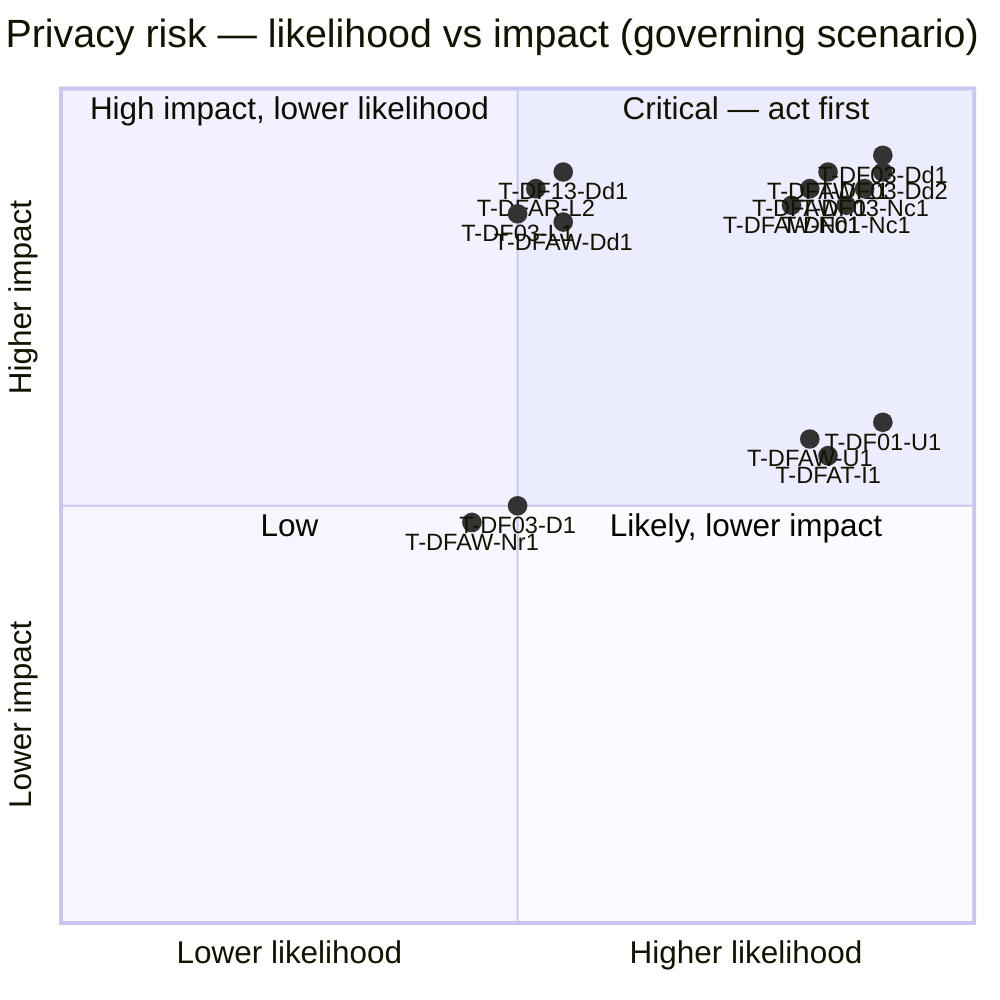

# Risk Prioritisation — Cross-Collection Retrieval and Audit Telemetry

**Document type:** Formal privacy-risk prioritisation
**Companion documents:**
[`linddun-elicitation-collection-audit.md`](./linddun-elicitation-collection-audit.md) (threats) ·
[`scoped-analysis-collection-audit.md`](./scoped-analysis-collection-audit.md) (scope) ·
[`privacy-dfd-system-model.md`](./privacy-dfd-system-model.md) (model)
**Validation:** The central disclosure threats are exercised by
`tests/components/vector_store/test_collection_isolation.py` (see §6).

---

## Table of contents

1. [Method](#1-method)
2. [Scoring scales](#2-scoring-scales)
3. [Per-threat risk assessment](#3-per-threat-risk-assessment)
4. [Risk matrix](#4-risk-matrix)
5. [Prioritised backlog](#5-prioritised-backlog)
6. [Test validation of the top risks](#6-test-validation-of-the-top-risks)
7. [How the audit architecture choice moves the risk](#7-how-the-audit-architecture-choice-moves-the-risk)
8. [Assumptions](#8-assumptions)

---

## 1. Method

The LINDDUN elicitation produced 34 source-grounded threats with only
*qualitative* severity. This document assigns a **repeatable risk rating** per
threat as `Risk = Likelihood × Impact`, assessed **per deployment scenario**
(model §9.3): `S0` default/demo, `S1` hardened self-hosted, `S2` target
multi-tenant.

Scenario matters because likelihood is scenario-dependent:

- Under **S0/S1 single-tenant**, cross-collection retrieval is a weaker concern
  (one tenant owns all collections), but the *default-on query logging* leak is
  fully present.
- Under **S2 multi-tenant** — the intended target — cross-collection retrieval
  is a severe confidentiality breach, and audit telemetry becomes necessary
  (activating the issue-2 threats).

Only threats whose `Risk ≥ Medium` in at least one scenario are carried into the
prioritised backlog (§5).

---

## 2. Scoring scales

**Likelihood** (how readily the threat is realised, given the code + scenario):

| Level | Score | Meaning |
|---|---|---|
| Rare | 1 | Needs an unlikely misconfiguration or external precondition. |
| Possible | 2 | Realisable with a plausible configuration or minor attacker effort. |
| Likely | 3 | Default/near-default behaviour, or trivially triggered. |

**Impact** (privacy harm if realised):

| Level | Score | Meaning |
|---|---|---|
| Low | 1 | Limited/metadata exposure, single subject, reversible. |
| Moderate | 2 | Meaningful personal-data exposure or profiling of one subject. |
| High | 3 | Bulk/identifying personal-data exposure, many subjects, or cross-tenant breach. |

**Risk = L × I**, banded: **Low** 1–2 · **Medium** 3–4 · **High** 6 · **Critical** 9.

---

## 3. Per-threat risk assessment

Likelihood/Impact are given for the scenario where the threat is most relevant;
the **Governing scenario** column states which. `→` shows how the rating shifts
across scenarios where material.

| Threat | Cat | Governing scenario | L | I | Risk | Scenario notes |
|---|---|---|:--:|:--:|---|---|
| **T-DF03-Dd1** cross-collection disclosure (filter absent) | Dd | S2 | 3 | 3 | **Critical** | S0/S1: L1·I1 Low (single tenant). S2: default `logical` applies filter, but `collection` mode / empty collection fail open → Likely×High. |
| **T-DF03-Dd2** filter is not authorisation | Dd | S2 | 3 | 3 | **Critical** | Any caller names any collection; no entitlement check anywhere (confirmed in code). S0/S1: Low. |
| **T-DF13-Dd1** whole-document cross-collection read | Dd | S2 | 2 | 3 | **High** | Same gap as DF03 but returns full documents → higher impact; slightly lower likelihood (content API less used than chat). |
| **T-DF03-L1** cross-collection linking | L | S2 | 2 | 3 | **High** | Depends on T-DF03-Dd1 being realised. |
| **T-DF03-Nc1** no enforced separation | Nc | S2 | 3 | 3 | **Critical** | TB-USER aspirational; non-compliance is structural, not incidental. |
| **T-DF03-D1** membership inference by score/latency | D | S2 | 2 | 2 | **Medium** | Side-channel; needs crafted probing, moderate signal. |
| **T-DF01-Nc1** unverified collection authorisation | Nc | S2 | 3 | 3 | **Critical** | Root cause of the Dd2/Nc1 family; present by design. |
| **T-DF01-U1** default-on INFO query logging | U | S0–S2 | 3 | 2 | **High** | **Scenario-independent**: on out of the box (condenser path). Query text (personal data) to logs with no notice. |
| **T-DFAW-L1** audit builds behavioural profile | L | S2 | 3 | 3 | **Critical** | If audit is added (required to mitigate issue 1), correlation is its purpose → Likely×High. |
| **T-DFAW-I1** attribution ties behaviour to identity | I | S2 | 3 | 3 | **Critical** | Inherent to an attributed audit trail. |
| **T-DFAW-Dd1** new sensitive behavioural store | Dd | S2 | 2 | 3 | **High** | High if queries stored verbatim; drops to Medium if hashed (mitigation 5). |
| **T-DFAW-U1** users unaware of security correlation | U | S2 | 3 | 2 | **High** | No notice/consent path exists. |
| **T-DFAW-Nc1** purpose/retention/rights unaddressed | Nc | S2 | 3 | 3 | **Critical** | Audit store would have no purpose-limitation/retention controls by default. |
| **T-DFAW-Nr1** loss of deniability | Nr | S2 | 2 | 2 | **Medium** | Privacy harm for legitimate users. |
| **T-DFAW-D1** flagged-status inferable | D | S2 | 1 | 2 | **Low** | Requires access to store internals. |
| **T-DFAR-L2** audit store itself cross-tenant leak | L | S2 | 2 | 3 | **High** | If DS-AUDIT not tenant-partitioned, an analyst sees other tenants' query history — a *second* cross-collection vector. |
| **T-DFAR-Dd1** analyst sees innocent users' queries | Dd | S2 | 2 | 3 | **High** | Over-broad analyst access to raw queries. |
| **T-DFAT-I1** attribution capture = identifiability | I | S2 | 3 | 2 | **High** | The step that makes the trail identifiable. |
| **T-DFAT-Nc1** audit presupposes S1+ auth / lawful basis | Nc | S2 | 2 | 2 | **Medium** | Coupling + lawful-basis question for new processing. |
| T-DF01-Dd1 open endpoint (S0) | Dd | S0 | 3 | 2 | **High** | S0 only: auth off + CORS open. Mitigated in S1+ (auth/TLS). |

*(Threats rated Low in every scenario — e.g. T-DFAW-D1 — are omitted from the
backlog but retained here for completeness.)*

---

## 4. Risk matrix

---

## 5. Prioritised backlog

Ordered by risk band, then by whether a mitigation unblocks others.

### P1 — Critical (address first)

1. **Enforce collection authorisation** (fixes T-DF01-Nc1, T-DF03-Dd2, T-DF03-Nc1).
   Bind caller identity → allowed collections *before* retrieval; stop trusting
   the request's `collection`. This is the structural fix for the aspirational
   TB-USER boundary and the root of the cross-collection family.
2. **Fail-closed tenancy filtering** (fixes T-DF03-Dd1).
   Always apply a tenancy constraint for every multitenancy mode; deny on
   empty/absent collection rather than running unscoped. **Directly validated by
   the two `*_desired` xfail tests (§6).**
3. **Audit minimisation + purpose/retention controls** (fixes T-DFAW-Nc1,
   reduces T-DFAW-Dd1/L1/I1). *Only if audit telemetry is built.* Store hashes +
   collection + attribution + anomaly flag, not raw queries; set purpose and
   retention explicitly.

### P2 — High

4. **Disable/guard default-on query logging** (fixes T-DF01-U1).
   Scenario-independent and cheap: stop logging raw query text at INFO, or gate
   it behind an explicit, disclosed setting. This is the one top risk present
   even in S0/S1 single-tenant.
5. **Tenant-partition the audit store** (fixes T-DFAR-L2) and **least-privilege
   analyst access** (fixes T-DFAR-Dd1).
6. **Transparency for audit processing** (fixes T-DFAW-U1, T-DFAT-U1).
7. **Harden S0 exposure** (fixes T-DF01-Dd1): enable auth + TLS + CORS
   restriction (i.e. deploy S1, not S0).

### P3 — Medium

8. Side-channel reduction for membership inference (T-DF03-D1).
9. Lawful-basis / S1-auth precondition for audit (T-DFAT-Nc1).
10. Deniability considerations (T-DFAW-Nr1).

---

## 6. Test validation of the top risks

The two **Critical/High** cross-collection threats are not just asserted — they
are pinned by an executable test:
`tests/components/vector_store/test_collection_isolation.py`.

| Test | Validates | Result today |
|---|---|---|
| `test_logical_multitenancy_scopes_to_requested_collection` | tenancy filter *is* applied in logical mode | **pass** |
| `test_logical_multitenancy_never_targets_other_collection` | filter for B never references A | **pass** |
| `test_filter_trusts_request_supplied_collection` | **T-DF03-Dd2** — filter is not authorisation | **pass** (documents the gap) |
| `test_empty_collection_no_tenancy_filter_current_behaviour` | **T-DF03-Dd1** — empty collection fails open | **pass** (pins current behaviour) |
| `test_physical_multitenancy_no_logical_filter_current_behaviour` | **T-DF03-Dd1** — physical mode adds no logical filter | **pass** (pins current behaviour) |
| `test_empty_collection_should_fail_closed_desired` | desired fail-closed behaviour | **xfail (strict)** — fails today, proving the gap |
| `test_physical_multitenancy_should_add_defence_in_depth_filter_desired` | desired defence-in-depth filter | **xfail (strict)** — fails today, proving the gap |

Interpretation: the `*_desired` tests are the **acceptance criteria for backlog
items P1.1/P1.2**. When those mitigations land, the strict xfails flip to a hard
failure, forcing the tests (and the threat model) to be updated — a built-in
regression gate tying the risk register to code.

Run: `make test PYTEST_ARGS="tests/components/vector_store/test_collection_isolation.py"`
(result at time of writing: **6 passed, 2 xfailed**).

---

## 7. How the audit architecture choice moves the risk

The issue-2 risks are *conditional on building audit telemetry* and are
sensitive to the Option A (internal) vs Option B (separate consumer) choice from
the scoped analysis §6/§8.3.

| Threat | Option A (internal) | Option B (minimised external) |
|---|---|---|
| T-DFAW-Dd1 (new store) | High — co-located with content, easy to over-collect | Medium — minimised export (hashes/refs) reduces impact |
| T-DFAW-L1/I1 (profiling) | High — content + audit trivially joined | Medium — separation limits joinability |
| T-DFAW-Nc1 (purpose limitation) | High — scope creep likely | Medium — distinct controller/retention enforceable |
| T-DFAR-L2 (cross-tenant audit) | High — must partition inside app | High — must partition in the external store (either way required) |
| New transit risk | — | +Medium — TB-AUDIT crossing (T-DFAW-Nc2) |

**Net:** a *governed, minimised Option B* lowers the residual risk of most
issue-2 threats at the cost of one new transit boundary; an *un-minimised* audit
(especially repurposing tracing or the default query log, scoped §8.4) raises
them. The architecture decision should therefore be treated as a risk-control in
its own right.

---

## 8. Assumptions

- **Scores are provisional and deployment-relative.** They order mitigation
  effort; they are not a substitute for a deployment-specific DPIA.
- **Issue-1 risks assume the S2 target.** Under genuine single-tenant S0/S1 the
  cross-collection family is Low (one owner), *except* the logging leak
  (T-DF01-U1) which is scenario-independent.
- **Issue-2 risks assume audit telemetry is built.** They are design-time risks
  guiding whether/how to build it; none exist in the current code.
- **Likelihood of T-DF03-Dd1 depends on multitenancy mode**, which needs runtime
  confirmation for the physical (`collection`) path (`qdrant_factory.py:62-90`).
- **Prompt injection excluded** (scoped §1); it could raise the likelihood of
  cross-collection access if untrusted document content can steer retrieval — a
  follow-up assessment if testing shows it.
---

*This prioritisation converts the LINDDUN elicitation into an actionable,
test-anchored backlog. The top items (P1.1/P1.2) have executable acceptance
criteria already in the test suite; the audit items (P1.3, P2.5–6) apply only if
audit telemetry is built and are sensitive to the Option A/B choice.*
