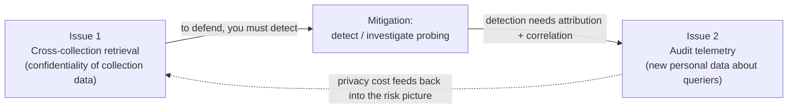
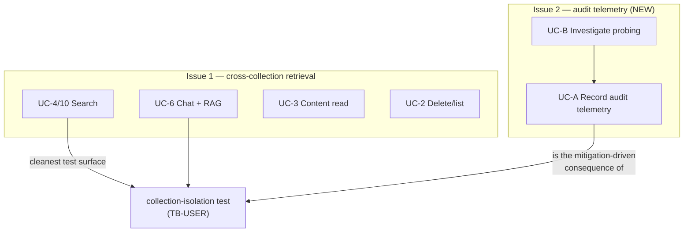
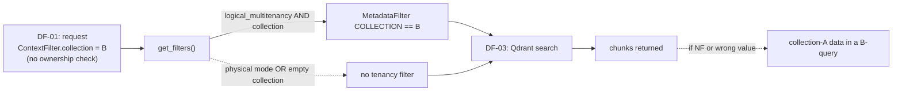
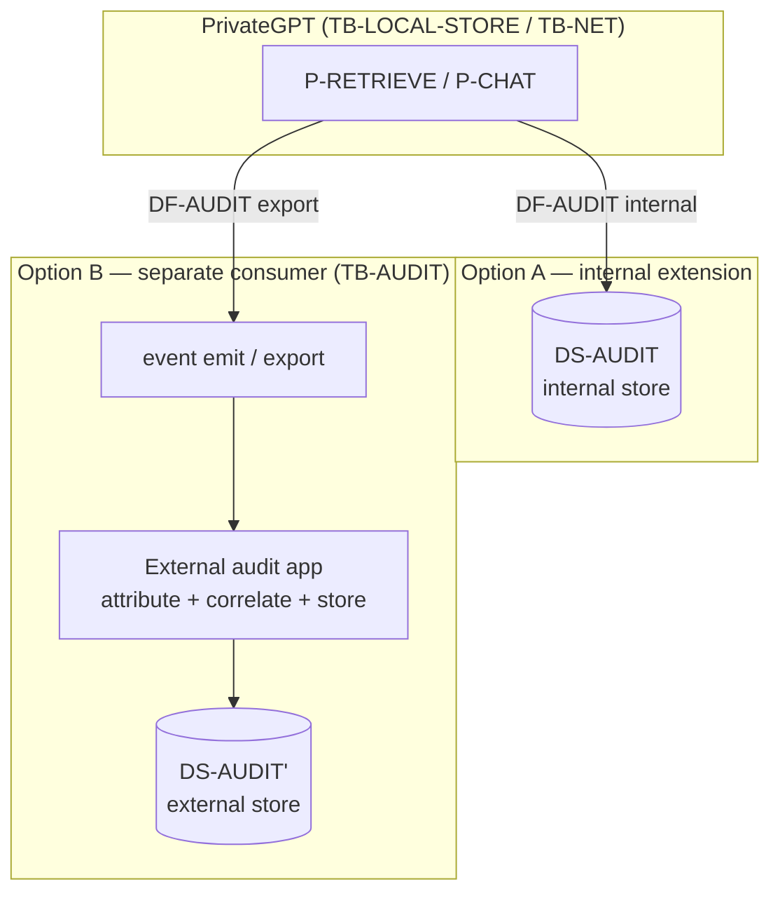
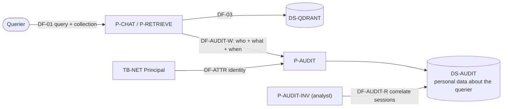
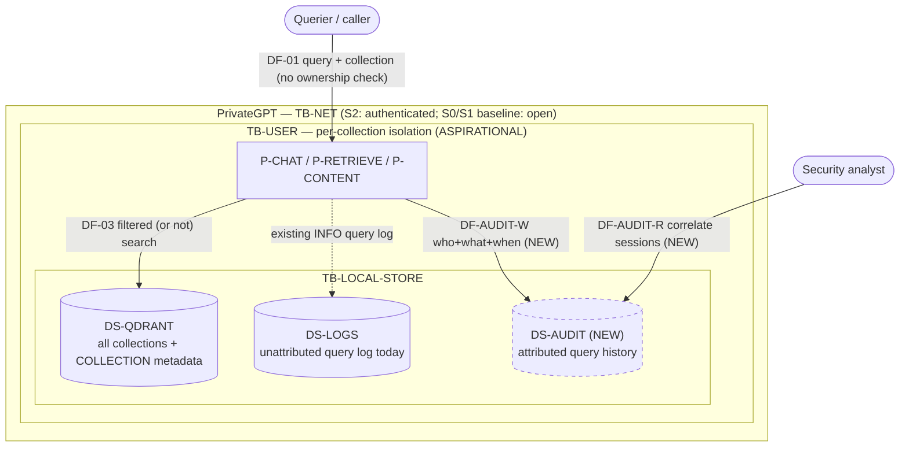

# Scoped Analysis — Cross-Collection Retrieval and Audit Telemetry

**Document type:** Scope definition and model extension, preparatory to a full LINDDUN PRO analysis
**Companion documents:**
[`privacy-dfd-system-model.md`](./privacy-dfd-system-model.md) (system model & DFDs) ·
[`use-cases.md`](./use-cases.md) (use-case catalogue)
**Status of this document:** Scoping + model extension. No LINDDUN threat elicitation is performed yet; this document defines *what* will be analysed and prepares the model elements needed for it.

---

## Table of contents

1. [Scope](#1-scope)
2. [Relevant parts of the system model and DFDs](#2-relevant-parts-of-the-system-model-and-dfds)
3. [Relevant use cases](#3-relevant-use-cases)
4. [Cross-collection retrieval: grounding in source code](#4-cross-collection-retrieval-grounding-in-source-code)
5. [Audit telemetry is not an existing feature](#5-audit-telemetry-is-not-an-existing-feature)
6. [How audit telemetry can be added, and its effect on trust boundaries](#6-how-audit-telemetry-can-be-added-and-its-effect-on-trust-boundaries)
7. [Model extension: audit telemetry DFD elements](#7-model-extension-audit-telemetry-dfd-elements)
8. [Privacy/security trade-off and the LINDDUN view](#8-privacysecurity-trade-off-and-the-linddun-view)
9. [Scoped target model (what the LINDDUN pass will cover)](#9-scoped-target-model-what-the-linddun-pass-will-cover)
10. [Assumptions and open questions](#10-assumptions-and-open-questions)

---

## 1. Scope

To keep the analysis experimentally manageable, the threat model is narrowed to
two tightly coupled issues:

1. **Cross-collection retrieval.** Can data associated with one collection
   influence a query that is authorised only for another collection?
2. **Audit telemetry.** What privacy risks arise when queries and retrieval
   activity are logged in order to detect or investigate deliberate attempts to
   cross collection boundaries?

The second issue is included because it is a **direct consequence of mitigating
the first**. Detecting systematic probing requires attribution and correlation
of user actions across sessions; that improves security accountability but
creates a **new body of personal data about the querying user**. The
security/privacy trade-off is therefore part of the same scoped problem.

**Explicitly out of scope** (unless needed to explain a collection or audit data
flow): MCP connectors, remote inference specifics, web search, code execution,
database/tabular tools. **Prompt injection** is not analysed as a primary threat
in this version; it may be added if testing shows untrusted document content can
cause cross-collection access or disclose audit data.



---

## 2. Relevant parts of the system model and DFDs

Against the companion system model, the scope selects a **small, well-defined
slice**. The table states, for each model element, whether it is in scope and
why.

### 2.1 Processes (P-*)

| Element | In scope? | Why |
|---|---|---|
| **P-RETRIEVE** (semantic retrieval) | **Core** | Where the collection filter is (or is not) applied; the locus of issue 1. |
| **P-CHAT** (chat orchestration) | In scope (as caller of retrieval in UC-6) | Supplies the `ContextFilter`/`collection` to retrieval; emits the query that gets logged. |
| **P-EMBED** (embedding client) | Boundary only | Query text is embedded before the Qdrant search; relevant only as the step that turns the query into a vector. Embedding *provider* egress (TB-INFER) is otherwise out of scope. |
| **P-CONTENT** (artifact content read) | In scope | A second collection-scoped read path (UC-3); same filter-as-access-control weakness. |
| **P-OBS** (observability pipeline) | In scope **as the nearest existing analogue** to audit telemetry (see §5–6) | Today it is the only mechanism that persists query/retrieval content; audit telemetry either extends this idea or stands beside it. |
| P-LLM, P-INGEST, P-TOOLS, P-CODEEXEC, P-MCP, P-WEBSEARCH/FETCH, P-DBQUERY, P-FILES, P-SKILLS | Out | Not on the collection-retrieval or audit path. P-INGEST is referenced only to explain how the `collection` metadata gets onto a node (§4). |

### 2.2 Data stores (DS-*)

| Element | In scope? | Why |
|---|---|---|
| **DS-QDRANT** | **Core** | Holds every collection's vectors + chunk text + the `collection` metadata key that is the sole isolation mechanism. The cross-collection question is a property of how this store is queried. |
| **DS-INDEX** | In scope (secondary) | Per-collection index structs read during retrieval/content. |
| **DS-LOGS** | **Core for issue 2** | The only *existing* place query text is persisted by default (the INFO `Condensing query` line). The baseline for "what is logged today". |
| **DS-TRACES** | In scope for issue 2 | When observability is on, persists full queries + retrieved text; the existing content-capture analogue to audit telemetry. |
| **DS-AUDIT** (new) | **Core for issue 2** | Introduced by this document (§7) — the store that audit telemetry would create. |
| DS-REDIS-STREAM, DS-CHECKPOINT, DS-FILES-LOCAL, DS-S3-*, DS-RELDB, DS-TEMPFILE | Out (mostly) | Not on the scoped path. DS-RELDB is referenced only as a *candidate* backing store for DS-AUDIT (§6). |

### 2.3 Data flows (DF-*)

| Flow | In scope? | Role in the scope |
|---|---|---|
| **DF-03** (P-RETRIEVE → EE-EMBED, DS-QDRANT: query embed + search) | **Core** | The retrieval flow whose collection filter defines issue 1. |
| **DF-01** (EE-CLIENT → P-CHAT: messages incl. the query + `collection`) | In scope | Carries the caller-supplied collection selector and the query that becomes audit data. |
| **DF-13** (P-CONTENT → EE-CLIENT: content read) | In scope | Collection-scoped bulk read (UC-3). |
| **DF-12** (P-OBS → DS-TRACES/EE-OTEL) | In scope | Existing content-capturing telemetry flow; reference point for audit telemetry. |
| **DF-AUDIT** (P-RETRIEVE/P-CHAT → DS-AUDIT) (new) | **Core for issue 2** | Introduced in §7. |
| DF-02, DF-04–DF-11, DF-14, DF-15 | Out | Inference, ingest, tools, files, embeddings-API — outside scope. |

### 2.4 Trust boundaries (TB-*)

| Boundary | In scope? | Role |
|---|---|---|
| **TB-USER** (inter-user / inter-tenant isolation — *aspirational*) | **Primary** | Issue 1 *is* the TB-USER question made concrete at the collection granularity. The model already records that no code binds caller identity to a collection. |
| **TB-NET** (client/API) | In scope | Where the caller supplies the `collection` selector and (S0) is unauthenticated; the point at which attribution for audit data would (or would not) be established. |
| **TB-LOCAL-STORE** (local data-at-rest; admin-as-adversary) | **In scope for issue 2** | Where DS-LOGS / DS-TRACES / DS-AUDIT live; retention and admin-access questions for audit data. |
| **TB-AUDIT** (new, if audit telemetry is a separate consumer) | Conditional | Introduced in §6/§7 for the "separate application" option. |
| TB-INFER, TB-PARSE, TB-TOOLS, TB-SANDBOX, TB-STORAGE | Out | Not exercised by the scoped flows (TB-INFER appears only as the embed hop of DF-03 and is not itself analysed). |

### 2.5 Deployment scenarios (model §9.3)

The scope is **most meaningful under S2 (target multi-tenant)**, since
"authorised only for another collection" presupposes per-collection
authorisation — which the model records as *aspirational, not enforced*
(TB-USER). The analysis therefore runs against **S2 as the intended target**,
using **S0/S1 as the as-is baseline** that demonstrates the gap. Topology
(S1 vs S1′) is not central here because the stores involved are local by
default.

---

## 3. Relevant use cases

From the use-case catalogue, the scope selects a tight subset. The selection
rationale maps directly onto the two issues.

| Use case | In scope? | Relevance to scope |
|---|---|---|
| **UC-6 — Chat with RAG** | **Primary** | The canonical path where a caller-supplied `collection` scopes retrieval that feeds the prompt. Exercises P-RETRIEVE + DF-03 + DS-QDRANT + TB-USER. This is where cross-collection influence would manifest end-to-end. |
| **UC-4 / UC-10 — Search (primitives / semantic-search tool)** | **Primary (minimal form)** | The *isolated* retrieval step without the chat loop — the cleanest experimental surface for issue 1 and for a collection-isolation test (query names collection B, assert no collection-A chunk returns). |
| **UC-3 — Retrieve artifact content** | In scope | A second collection-scoped read; bulk read-back makes any isolation gap maximally impactful. |
| **UC-2 — Delete / manage artifacts** | In scope (secondary) | `list`/`delete` are also collection-scoped with no ownership check; relevant to whether a prober can enumerate another collection. |
| **UC-1 — Ingest** | Referenced only | Explains how the `collection` metadata value is written onto nodes (§4); not itself analysed. |
| **(new) UC-A — Record audit telemetry** | **Primary for issue 2** | Not in the current catalogue because the feature does not exist. Defined in §7. Covers the logging of query + collection + attribution for probing detection. |
| **(new) UC-B — Investigate probing** | In scope for issue 2 | The analyst-facing read of audit data; where correlation across sessions (and its privacy cost) happens. |
| UC-5, UC-7, UC-8, UC-9, UC-11–UC-20 | Out | Outside the collection/audit path per the scope exclusions. |



---

## 4. Cross-collection retrieval: grounding in source code

The entire isolation guarantee for issue 1 rests on **one metadata filter**.
Tracing the path:

1. The caller supplies the collection in the request body. `ContextFilter.collection`
   defaults to `pgpt_collection` and is a free string with **no ownership
   check** (`private_gpt/chat/extensions/context_filter.py:22-26`). The same
   field is used by chat (UC-6), primitives search (UC-4), and content read
   (UC-3).
2. Ingestion stamps each node with its collection as Qdrant payload metadata
   (`components/ingest/ingest_component.py:193-213`;
   `components/ingest/metadata_helper.py`), i.e. the key `MetadataKeys.COLLECTION`.
3. Retrieval builds the filter in
   `VectorStoreComponent.get_filters`
   (`components/vector_store/vector_store_component.py:98-111`). The tenancy
   filter is added **only** when:

   ```python
   if self.logical_multitenancy and collection:
       tenancy_filter = MetadataFilter(
           key=MetadataKeys.COLLECTION.value, value=collection
       )
       ...
   ```

   i.e. only when `vectorstore.multitenancy == "logical"` **and** a non-empty
   `collection` is passed (`vector_store_component.py:70-71, 101-105`).

This yields three concrete cross-collection conditions to analyse:

- **Filter-as-access-control, not authorisation.** Even when applied, the filter
  trusts the request's `collection` string. Any caller may name any collection;
  nothing checks entitlement. This is the TB-USER gap at collection granularity.
- **Mode-dependent absence of the filter.** Under `multitenancy == "collection"`
  (physical) the logical tenancy filter is **not** added here; isolation then
  depends entirely on the physical collection routing
  (`components/vector_store/qdrant_factory.py:62-90`). If the physical routing
  resolves to a shared/default collection, cross-collection leakage is possible.
- **Empty/missing collection.** If `collection` is falsy, the tenancy filter is
  skipped and the query runs unscoped over whatever the underlying store exposes.

These are the exact predicates a **collection-isolation test** should assert
against (query authorised for B must never return A's chunks), and they are the
flows the LINDDUN PRO step will examine for Data Disclosure / Linking / Detecting.



---

## 5. Audit telemetry is not an existing feature

A source search for an audit/access-log facility returns **nothing**
(`audit`, `AuditLog`, `access_log` — no matches in `private_gpt/`). What exists
today is:

- **Unattributed query logging.** `logger.info(f"Condensing query: {ev.query}")`
  (`components/workflows/retrieval/semantic_search.py:186`) writes the query text
  to stdout at INFO. It records **no user, tenant, or collection identity**, so
  it cannot by itself support cross-session attribution of a prober.
- **Content-capturing traces (off by default).** The observability pipeline,
  when `observability.mode=otel`, persists full prompts, queries, and retrieved
  text to `DS-TRACES` (`observability/exporters.py:63-120`).

**OpenTelemetry tracing is not auditing — the difference is purpose, not just
default state.** The module describes itself as *"vendor-neutral tracing"*
(`observability/__init__.py`); it is distributed-tracing instrumentation for
*diagnostics and performance*, and the fact that it can record a query and the
retrieved documents (`observability/tracing.py:retrieval_documents`) is
incidental debug context, not an access record. It differs from audit telemetry
on exactly the axes LINDDUN cares about:

| Property | OpenTelemetry tracing (`P-OBS` → `DS-TRACES`) | Audit telemetry (`DS-AUDIT`, §7) |
|---|---|---|
| Purpose | Diagnostics / performance | Security accountability (detect probing) |
| Subject of the data | The request/span (latency, errors, span tree) | The **querying user** (identity + behaviour) |
| Attribution | Not attributed to a data subject by design | Attribution is the whole point |
| Cross-session correlation | Not a goal (history even capped per span) | The goal |
| Default | Off (`observability.mode: none`) | A control one would want on |
| Retention | Size-rotated debug file (50MB×5) | Policy-driven audit retention |

So tracing is the *nearest existing analogue* to audit telemetry and a possible
insertion point (§6), but it is **not** audit telemetry.

**Standard logging carries the same two concerns as tracing — but is on by
default and is a worse audit substitute.** Unlike observability (off by
default), application logging runs at `INFO` out of the box (`debug_mode: false`
→ `logging.INFO`, e.g. `di.py:27-30`). On the scoped RAG path the default
`condense_strategy: condenser` (`settings.yaml`) means the condense branch runs
on multi-turn queries, and it logs the **full user query text at INFO**:
`logger.info(f"Condensing query: {ev.query}")`
(`components/workflows/retrieval/semantic_search.py:186`). Reader modules also
log `file_name` at INFO (e.g. `readers/pptx2md/pptx2md_reader.py:293`). More
query/prompt content is logged at `DEBUG` only (`retrieval.py:143,254`,
`workflows/others/condenser.py:115`, `llm/prompt_styles/prompt_style_base.py:126,132`).
Two consequences, both LINDDUN-relevant:

- **PII leakage (default-on).** Query text — potentially personal data — reaches
  stdout/log files with no opt-in, so this is the *baseline* Data-Disclosure /
  Unawareness surface, present before any observability is enabled. It is
  content-lighter than traces but always active.
- **Worse as an audit substitute.** The INFO query log is **unattributed** (bare
  query string; no user/tenant/collection), so it cannot support issue-2's
  cross-session attribution. If logs were repurposed as an audit trail it would
  incur the same purpose-limitation / Unawareness hazard as reusing tracing
  (§8.4), *plus* a looser-governance hazard: logs are typically fanned out to
  aggregation/retention systems with broad operator access and no tenant
  isolation.

Both tracing and logging are modelled as the existing store `DS-LOGS` /
`DS-TRACES` in the system model; neither is audit telemetry.

**Consequence for the model.** Issue 2 cannot be analysed against existing
features alone, because the capability that creates the privacy risk — an
*attributed, correlatable* record of who queried what collection — **does not
exist yet**. The scope must therefore introduce audit telemetry as a modelled
extension. Crucially, the privacy risk of issue 2 appears *precisely because*
mitigating issue 1 requires adding the attribution that the current query log
lacks.

---

## 6. How audit telemetry can be added, and its effect on trust boundaries

Because audit telemetry does not exist today (§5), it has to be *added*, and the
way it is added determines which trust boundaries the audit data crosses. At a
mechanical level, PrivateGPT already exposes three insertion points where an
audit record could be produced without changing the retrieval logic:

- **In-process hook at `P-RETRIEVE` / `P-CHAT`** — the point where the
  `collection` selector and the query are already in hand (the same place the
  existing INFO query log is emitted,
  `components/workflows/retrieval/semantic_search.py:186`).
- **The observability pipeline** — `P-OBS` already folds query and retrieved
  text into spans and exports them (`observability/exporters.py:63-120`); an
  audit consumer could subscribe to an exporter rather than the code being
  changed. **Caveat:** this pipeline is *diagnostics* tracing, not auditing
  (§5). Reusing it as the audit mechanism changes its purpose without changing
  its code, which is itself a purpose-limitation / Unawareness hazard (§8.3) —
  data collected under a "debugging" notice would be repurposed for security
  surveillance of users.
- **The streaming/event mechanism** — retrieval activity already flows through
  the stream broker when `stream.broker=redis`
  (`components/streaming/stream/registry.py:26-33`), which an external consumer
  could tap.
- **Application logs** — the lowest-effort option: the INFO query log already
  exists (§5). It is also the **worst-governed** audit substitute (unattributed,
  fanned out to log aggregators with broad access and no tenant isolation), so
  it is noted here as an *anti-pattern* rather than a recommended path.

Whichever insertion point is used, the privacy-relevant design decision is
**where the resulting audit data lives and who controls it**, because that is
what sets the trust boundary the audit data crosses. At least two architectural
options exist, and they sit at opposite ends of that decision:

- **Option A** keeps the audit data *inside* PrivateGPT's own trust zone
  (`TB-LOCAL-STORE`) — no new network crossing, same operator.
- **Option B** moves it *out* to a separate consumer across a **new boundary
  (`TB-AUDIT`)** — a distinct component, team, or operator.

Other hybrids are possible (e.g. emit internally but forward a minimised subset
externally); the two options below bound the design space and are sufficient to
expose the LINDDUN trade-off. The resulting boundary changes are modelled in §7
and compared in §8.3.

### Option A — Extend PrivateGPT (audit as an internal feature)

Audit records are produced inside the application (at `P-RETRIEVE` / `P-CHAT`)
and written to an internal store (`DS-AUDIT`), e.g. a new table in `DS-RELDB`
or a dedicated append-only log. The audit data stays **inside TB-LOCAL-STORE**,
under the same operator.

### Option B — Separate consumer application (audit as another system)

PrivateGPT **emits** events (or exposes them via the existing trace/stream
mechanisms) and a **separate application** ingests, attributes, correlates, and
stores them. The audit data crosses a **new trust boundary (TB-AUDIT)** to a
different component — possibly a different team or even a different operator
(a SIEM, as Zylon's enterprise offering does per the README).



---

## 7. Model extension: audit telemetry DFD elements

To make issue 2 analysable, the following elements are **added** to the model
for the scoped analysis (to be back-ported into the system model if the design
is adopted).

### New processes

- **P-AUDIT — Audit recorder.** Produces an audit record for each retrieval /
  content read: timestamp, caller attribution (from `Principal`/`TB-NET`),
  requested `collection`, query (or a hash/summary of it), result references,
  and whether a cross-collection anomaly was detected. *Does not exist today.*
- **P-AUDIT-INV — Audit investigation.** Analyst-facing read/correlation over
  `DS-AUDIT` to detect systematic probing. *Does not exist today.*

### New data store

- **DS-AUDIT — Audit trail.** Attributed, append-only records of query/retrieval
  activity. Contents are **personal data about the querying user** (identity +
  behavioural history), distinct from the collection *content*. Retention is a
  policy choice central to the trade-off (§8).

### New data flows

| Flow | Source → Dest | Data categories | Personal data | Boundary |
|---|---|---|---|---|
| **DF-AUDIT-W** | P-RETRIEVE/P-CHAT → P-AUDIT → DS-AUDIT | caller id, collection, query(+hash), result refs, anomaly flag | **Yes — about the querier** | TB-LOCAL-STORE (Opt A) / TB-AUDIT (Opt B) |
| **DF-AUDIT-R** | P-AUDIT-INV → DS-AUDIT | correlated query history per user/session | **Yes — about the querier** | TB-LOCAL-STORE (A) / TB-AUDIT (B) |
| **DF-ATTR** | TB-NET (Principal) → P-AUDIT | caller identity claims | Yes | internal |

### New / affected boundaries

- **TB-AUDIT** (Option B only) — crossing to the separate audit consumer.
- **TB-USER** gains a second meaning: audit data must *itself* be isolated per
  tenant, or the audit system becomes a cross-tenant disclosure vector.

### New use cases (defined here, candidate for the catalogue)

- **UC-A — Record audit telemetry** (actor: system, triggered by UC-3/4/6).
- **UC-B — Investigate probing** (actor: security analyst/operator).



---

## 8. Privacy/security trade-off and the LINDDUN view

Audit telemetry is a textbook security/privacy tension: it is a **Detecting**
control for issue 1 that simultaneously **creates** Linking/Identifying exposure
for the querier. The LINDDUN categories make the trade-off precise.

### 8.1 What audit telemetry mitigates (security side)

- Enables detection of **systematic probing** across sessions (the behaviour
  issue 1's attacker exhibits), by correlating query/collection patterns per
  user — a **Detecting**-supporting and accountability (non-repudiation for
  security) control.

### 8.2 What audit telemetry introduces (privacy side), by LINDDUN category

| LINDDUN category | New risk from audit telemetry |
|---|---|
| **Linking** | Correlating a user's queries across sessions links otherwise separate actions into a behavioural profile. The *more effective* the probing detection, the *stronger* the linking. |
| **Identifying** | Attribution (required for investigation) ties queries to a real identity; the unattributed INFO log today does not do this. |
| **Non-repudiation** | An audit trail is non-repudiation *by design* — desirable for security, but it removes plausible deniability for legitimate users and can be a privacy harm (e.g. queries revealing health/legal interest). |
| **Detecting** | The audit store itself becomes a target: its existence/length can reveal whether a user was flagged. |
| **Data Disclosure** | A new store of sensitive behavioural data (queries can contain personal data) with its own access, retention, and breach surface. |
| **Unawareness** | Users are typically unaware their queries are retained and correlated for security; transparency/consent obligations arise. |
| **Non-compliance** | Purpose limitation (security ≠ open-ended analytics), retention limits, and data-subject rights now apply to the audit store. |

### 8.3 Option A vs Option B — LINDDUN comparison

| Dimension | Option A (internal extension) | Option B (separate consumer) |
|---|---|---|
| **Trust boundaries** | Audit data stays inside TB-LOCAL-STORE; no new network crossing. Fewer crossings = smaller Disclosure surface in transit. | Adds TB-AUDIT (and possibly an organizational boundary / processor). More crossings → more Disclosure/Non-compliance surface, but also clearer separation of duties. |
| **Linking / Identifying** | Attribution and collection content sit in the *same* system → easy to correlate audit with content; convenient but concentrates linkage. | Correlation happens in a dedicated system; can enforce that the audit app sees *references/metadata*, not collection *content* → data minimisation by construction. |
| **Purpose limitation / Non-compliance** | Risk of scope creep: the same operator may reuse audit data for analytics. Harder to prove purpose limitation. | Separation makes purpose limitation enforceable (distinct controller/processor, distinct retention policy, distinct access control). |
| **Detecting (of the audit itself)** | Audit store co-located with content; an admin-as-adversary (TB-LOCAL-STORE) sees both. | Admin of PrivateGPT need not have access to the audit store; reduces insider risk on one side, but the audit operator becomes a new trusted party. |
| **Non-repudiation / integrity** | Integrity depends on the app's own store; an app compromise can tamper with its own audit trail. | External append-only store can provide stronger tamper-evidence (classic SIEM property). |
| **Minimisation leverage** | Tempting to log full query text inline. | Natural point to hash/tokenise queries and strip content before export. |
| **Data-subject rights** | One system to service access/erasure requests, but audit vs content retention conflict inside it. | Rights must be coordinated across two systems (harder), but retention can be set independently. |
| **Unawareness** | Same privacy notice as the app. | Requires disclosing a second recipient/processor to data subjects. |

**Reading.** From a pure *in-transit Disclosure* view, Option A has fewer
crossings. From a *purpose-limitation, minimisation, and separation-of-duties*
view — which is where LINDDUN's Non-compliance, Linking, and Detecting
categories bite hardest — **Option B is often preferable**, provided the export
is minimised (references/hashes, not raw queries) and TB-AUDIT is a controlled
boundary. The decision is itself a LINDDUN-relevant design choice and should be
recorded as such, not made implicitly.

### 8.4 Special case: repurposing the OpenTelemetry pipeline as the audit trail

A tempting shortcut is to treat the existing OpenTelemetry tracing (§5) as the
audit mechanism — turn on `observability.mode=otel`, enable content capture, and
point an exporter at a retained store. It is cheap because no retrieval code
changes. From a LINDDUN view it is the **worst** of the options unless
deliberately re-governed, because it *silently changes the purpose of an
existing collection*:

- **Non-compliance (purpose limitation).** The pipeline is instrumented and
  documented as *diagnostics* tracing (`observability/__init__.py`). Reusing its
  output for security surveillance of users is secondary-use of data collected
  under a different purpose — the classic purpose-limitation violation.
- **Unawareness / Transparency.** Any privacy notice covering "debugging traces"
  does not cover "we profile your query behaviour for security"; data subjects
  are unaware of the real processing.
- **Minimisation.** Traces capture *full* prompts, queries, and retrieved text
  (content, not references), so an audit built on them is maximally rich — the
  opposite of the minimised, reference-only audit record Option B can enforce.
- **Detecting / scope.** Trace content capture is global
  (`capture_http_paths`, `capture_content`), so repurposing it collects far more
  than the collection/query metadata the probing-detection purpose needs.

If the OTel pipeline is used at all, it should feed a **purpose-built, minimised
audit path** (hash/tokenise queries, keep collection + attribution + anomaly
flag, drop content), governed and disclosed as auditing — effectively turning it
back into Option A or B with an explicit purpose, not a silent reuse of
diagnostics data.

---

## 9. Scoped target model (what the LINDDUN pass will cover)

Bringing §2–§8 together, the LINDDUN PRO pass will analyse the following reduced
DFD (existing elements solid; added elements dashed).



**Elements in the scoped pass:**

- **Processes:** P-RETRIEVE, P-CHAT, P-CONTENT; P-AUDIT, P-AUDIT-INV (new).
- **Stores:** DS-QDRANT, DS-INDEX, DS-LOGS, DS-TRACES; DS-AUDIT (new).
- **Flows:** DF-01, DF-03, DF-13; DF-AUDIT-W, DF-AUDIT-R, DF-ATTR (new).
- **Boundaries:** TB-USER (primary), TB-NET, TB-LOCAL-STORE; TB-AUDIT (Option B).
- **Use cases:** UC-6, UC-4/UC-10, UC-3, UC-2; UC-A, UC-B (new).
- **Scenario:** S2 target multi-tenant as the intended design; S0/S1 as the
  as-is baseline showing the TB-USER gap.

Everything else from the system model is explicitly **out of scope** for this
pass.

---

## 10. Assumptions and open questions

- **Attribution source.** The scoped model assumes audit attribution would be
  derived from the `Principal` (`server/principal.py`) captured at TB-NET. Under
  S0 (auth off) there is no reliable identity, so meaningful audit telemetry
  *presupposes* at least S1 auth — another coupling between issues 1 and 2.
- **Collection ownership.** There is currently no mapping from caller identity to
  "collections this caller may use". Issue 1's mitigation requires inventing one;
  this model treats it as part of the aspirational TB-USER boundary.
- **Multitenancy mode.** The analysis must cover both `logical` and `collection`
  multitenancy, because the tenancy filter is applied only in the logical case
  (`vector_store_component.py:101-105`); the physical-mode isolation path
  (`qdrant_factory.py:62-90`) needs separate confirmation of whether distinct
  collections map to distinct physical stores.
- **Option choice not yet made.** §6/§8 deliberately keep Option A and Option B
  open; the LINDDUN pass should treat the choice as a design decision with the
  documented trade-offs, not assume one.
- **Query content as personal data.** The model treats query text as potentially
  personal data (content-agnostic system), so audit records are personal data
  even if they store only queries, independent of the collection content.

---

*This document scopes the first LINDDUN PRO pass to cross-collection retrieval
and its audit-telemetry consequence, selects the relevant model and use-case
elements, grounds the cross-collection condition in source code, and extends the
model with the audit elements that do not yet exist in the software. The LINDDUN
threat elicitation itself is the next deliverable.*
