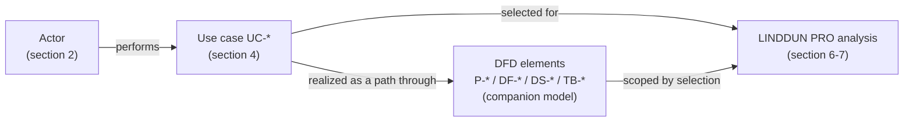
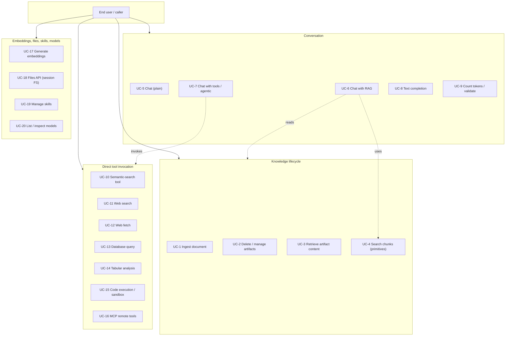
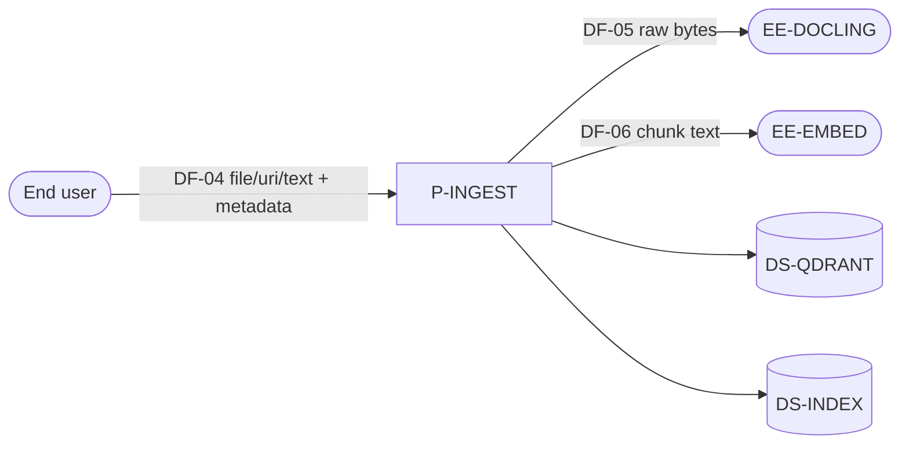
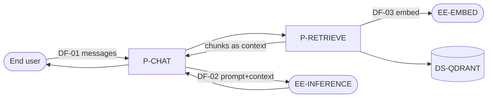
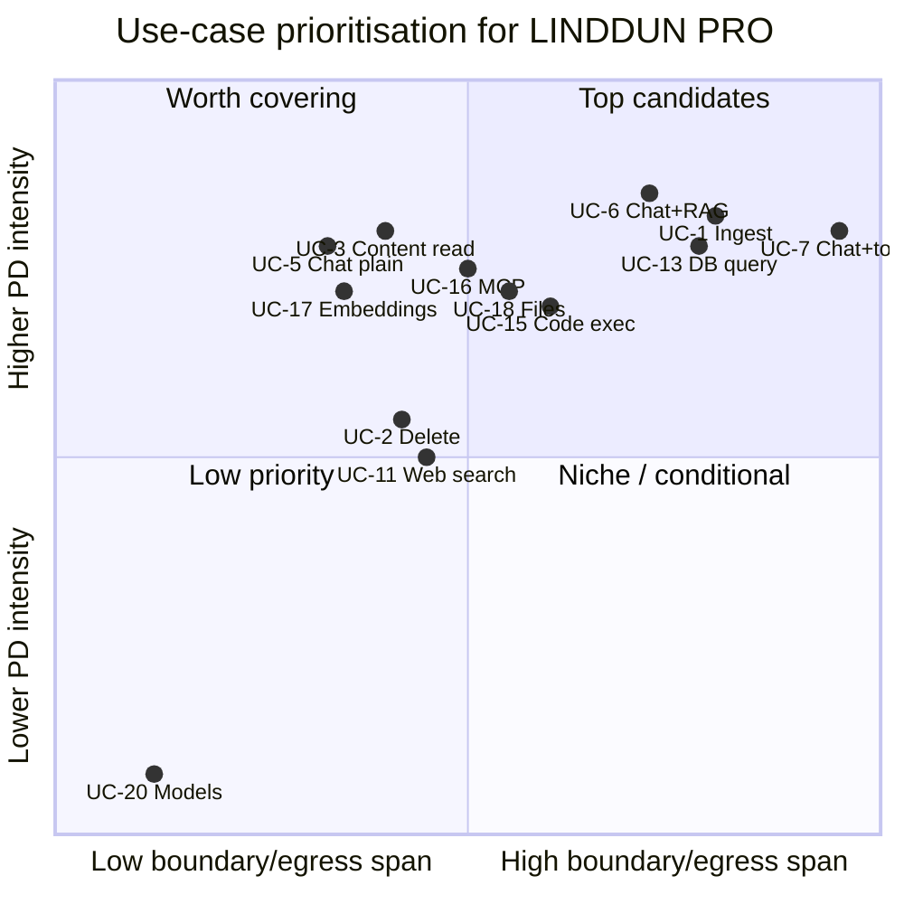
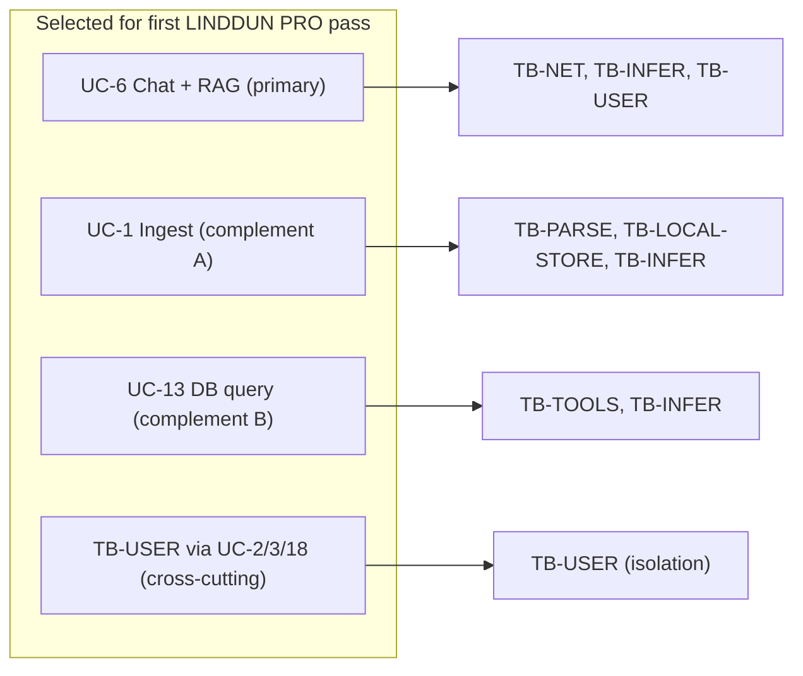

# PrivateGPT — Use-Case Catalogue and Mapping to the DFD / System Model

**Document type:** Use-case catalogue, linked to the system model
**Companion document:** [`privacy-dfd-system-model.md`](./privacy-dfd-system-model.md) (Data Flow Diagrams, trust boundaries, flow catalogue)
**Target repository:** `zylon-ai/private-gpt` (local working copy)
**Purpose:** Enumerate the use cases the software actually supports, map each to the DFD elements it exercises, and recommend one or more use cases to carry into a **full LINDDUN PRO privacy analysis**.

> **Scope.** This catalogue describes *end-user / functional* use cases — what an
> external actor achieves through the public HTTP API. Operator/deployment
> concerns (choosing providers, enabling observability, topology S0/S1/S1′/S2)
> are captured as *conditions* on these use cases and in the companion model's
> section 9.3, not as separate use cases here. Every use case is grounded in an
> actual API route; evidence is cited as `path:line` relative to the repo root
> (`private_gpt/`).

---

## Table of contents

1. [How this links to the DFD / system model](#1-how-this-links-to-the-dfd--system-model)
2. [Actors](#2-actors)
3. [Use-case overview map](#3-use-case-overview-map)
4. [Use-case catalogue](#4-use-case-catalogue)
5. [Use-case → DFD element traceability](#5-use-case--dfd-element-traceability)
6. [Selecting use cases for LINDDUN PRO](#6-selecting-use-cases-for-linddun-pro)
7. [Recommended candidates](#7-recommended-candidates)

---

## 1. How this links to the DFD / system model

The companion system model describes the system *structurally*: processes (P-*),
external entities (EE-*), data stores (DS-*), data flows (DF-01…DF-15), and
trust boundaries (TB-*) across deployment scenarios (S0 default, S1 self-hosted,
S1′ cloud-backed, S2 multi-tenant — see model §9.3).

This document describes the system *behaviourally*: each **use case (UC-*)** is
an end-to-end task an actor performs, realized as a path through those
structural elements. The link is explicit — every use case lists the processes,
flows, stores, and boundaries it exercises (section 5). This is what lets us
choose a use case and immediately know which DFD crossings a LINDDUN PRO
elicitation must cover.

A use case is the natural *unit of selection* for LINDDUN PRO because privacy
threats are elicited per data-flow-at-a-boundary, and a use case is exactly the
bundle of flows-and-boundaries that a real interaction activates.

---

## 2. Actors

| Actor | Description | Trust / boundary note |
|---|---|---|
| **End user / caller** (`EE-CLIENT`) | Any client of the HTTP API: a developer's app, an agent, Claude Desktop, n8n, or the bundled `/ui`. Supplies prompts, documents, tool definitions, MCP configs, DB connection strings. | Outside `TB-NET`. Under S0 the boundary is open (auth off); under S1+ a shared-secret gate applies. No inter-user separation (`TB-USER` aspirational). |
| **Data subject** | The person whose personal data appears *inside* the content an end user submits or ingests (document subjects, people named in prompts, rows in a queried DB). Often **not** the caller and typically unaware of the processing. | Relevant to Unawareness / Non-compliance threats; rarely has a direct interface. |
| **Model / tool loop** (internal, LLM-directed) | During a chat turn the LLM selects tools and emits tool arguments / SQL / URLs. A *secondary actor* that steers egress (`TB-TOOLS`, `TB-SANDBOX`) without operator foresight. | Model-directed egress is a defining property of the tool use cases. |
| **Operator** | Configures providers, topology, auth, observability. Not an API actor; sets the conditions (scenario) under which the use cases run. | Admin-as-adversary at `TB-LOCAL-STORE`. |

---

## 3. Use-case overview map

---

## 4. Use-case catalogue

Each use case lists: the actor, the entry point, the main flow, the data
involved (with personal-data potential), the DFD elements exercised, the trust
boundaries crossed, and the default-posture status.

### UC-1 — Ingest a document (sync or async)

- **Actor:** End user. **Entry point:** `POST /v1/artifacts/ingest`, `POST /v1/artifacts/ingest/async` (`server/ingest/ingest_router.py`).
- **Main flow:** Client submits a file (base64), URI, or text + metadata → scheduler (`P-SCHED`, local by default) → `IngestService.populate_vector_index` (`P-INGEST`) → reader (Docling by default) parses → nodes chunked, embedded → stored in Qdrant + index JSON.
- **Data:** Raw document bytes, extracted text, metadata (`file_name`, author, dept, `project_id`, `org_id`). High personal-data potential.
- **DFD:** `P-SCHED`, `P-INGEST`, `P-EMBED`; `DF-04` (ingest in), `DF-05` (→ Docling), `DF-06` (chunk embed); stores `DS-QDRANT`, `DS-INDEX`, `DS-TEMPFILE`, (celery) `DS-S3-TEMP`.
- **Boundaries:** `TB-NET`, `TB-PARSE`, `TB-INFER` (embed), `TB-LOCAL-STORE`.
- **Status:** default-on (parsing endpoint config-dependent on Docling).

### UC-2 — Delete / manage artifacts

- **Actor:** End user. **Entry point:** `POST /v1/artifacts/delete`, `/delete/async`, `GET /v1/artifacts/list` (`server/ingest/ingest_router.py`).
- **Main flow:** Client names a `collection` + `artifact` → scheduler → `VectorArtifactIndex.delete` removes vectors/nodes; list returns ingested docs for a collection.
- **Data:** Collection/artifact identifiers; list returns metadata incl. `file_name`.
- **DFD:** `P-SCHED`, `P-INGEST`; stores `DS-QDRANT`, `DS-INDEX`.
- **Boundaries:** `TB-NET`, `TB-LOCAL-STORE` (deletion/erasure), `TB-USER` (any caller may name any collection — no ownership check).
- **Status:** default-on. **Privacy relevance:** this is the *erasure / retention* path (right-to-be-forgotten) and the clearest place the missing `TB-USER` isolation bites.

### UC-3 — Retrieve full / chunked artifact content

- **Actor:** End user. **Entry point:** `POST /v1/artifacts/content`, `/chunked-content` (`server/content/content_router.py`).
- **Main flow:** Client supplies a `context_filter` (collection/artifacts/metadata) → `ContentService` returns the full or chunked stored document content back to the caller.
- **Data:** Complete ingested document text/structure. High personal-data potential.
- **DFD:** `P-CONTENT`; `DF-13` (content out); reads `DS-QDRANT`/`DS-INDEX`.
- **Boundaries:** `TB-NET`, `TB-USER` (filter-only scoping).
- **Status:** default-on. **Privacy relevance:** bulk read-back of stored personal data with only a request-supplied filter as the gate.

### UC-4 — Search chunks via primitives

- **Actor:** End user. **Entry point:** `POST /v1/primitives/search` (`server/primitives/primitives_router.py`). Only `semantic_search` is implemented; keyword/hybrid return 501.
- **Main flow:** Query text → embed → Qdrant similarity search → ranked chunks (with optional adjacent context) returned.
- **Data:** Query text + returned chunk text/metadata. Personal-data potential both directions.
- **DFD:** `P-RETRIEVE`, `P-EMBED`; `DF-03`; `DS-QDRANT`.
- **Boundaries:** `TB-NET`, `TB-INFER` (embed), `TB-USER`.
- **Status:** default-on.

### UC-5 — Chat, plain (no retrieval, no tools)

- **Actor:** End user. **Entry point:** `POST /v1/messages`, `/v1/messages/async` (`server/chat/chat_router.py`, `server/chat_async/`).
- **Main flow:** Messages → `ChatService.stream_chat` (`P-CHAT`) → LLM (`P-LLM`) → streamed/returned response.
- **Data:** Prompts, full message history, system prompt — incl. **verbatim user text** (raw personal data). Streamed events may persist in a broker (TTL) when `broker=redis`.
- **DFD:** `P-CHAT`, `P-LLM`; `DF-01` (in), `DF-02` (→ inference); store `DS-REDIS-STREAM` (config), `DS-CHECKPOINT` (arq).
- **Boundaries:** `TB-NET`, `TB-INFER`.
- **Status:** default-on.

### UC-6 — Chat with retrieval-augmented generation (RAG)

- **Actor:** End user (RAG triggered when the model calls `semantic_search`). **Entry point:** `POST /v1/messages`.
- **Main flow:** UC-5 plus a retrieval step: query (optionally condensed) → embed → Qdrant → retrieved chunks folded into the prompt as context; response may carry citations.
- **Data:** Everything in UC-5 **plus** retrieved document chunks (personal data from ingested corpus) now sent to the LLM.
- **DFD:** `P-CHAT`, `P-RETRIEVE`, `P-EMBED`, `P-LLM`; `DF-01`, `DF-03`, `DF-02`; `DS-QDRANT`.
- **Boundaries:** `TB-NET`, `TB-INFER` (both embed and inference), `TB-USER`.
- **Status:** default-on. **Privacy relevance:** couples ingested personal data to third-party inference egress — the core product flow.

### UC-7 — Chat with tools / agentic loop

- **Actor:** End user + LLM-directed tool loop. **Entry point:** `POST /v1/messages` with `tools` / `mcp_servers` / artifacts.
- **Main flow:** The chat engine runs an iterative loop; the LLM emits tool calls that are dispatched to the tool framework (`P-TOOLS`) and their results folded back into the prompt. May invoke any of UC-10…UC-16.
- **Data:** Prompts/history + whatever each selected tool sends/returns (DB rows, web content, code output, MCP results).
- **DFD:** `P-CHAT`, `P-TOOLS`, plus the specific tool processes; flows `DF-02` and `DF-07…DF-11` as applicable.
- **Boundaries:** `TB-NET`, `TB-INFER`, `TB-TOOLS`, `TB-SANDBOX` — **the widest boundary span of any use case.**
- **Status:** default-on framework; individual tools gated by flags/artifacts. **Privacy relevance:** model-directed, caller-configurable egress to unvetted third parties.

### UC-8 — Text completion

- **Actor:** End user. **Entry point:** `POST /v1/complete` (`server/completion/completion_router.py`). Internally mapped onto a chat request.
- **Main flow:** Prompt → mapped to chat body → `ChatService.chat` → LLM → completion text.
- **DFD / boundaries:** same as UC-5 (`P-CHAT`, `P-LLM`; `DF-02`; `TB-NET`, `TB-INFER`).
- **Status:** default-on.

### UC-9 — Count tokens / validate a request

- **Actor:** End user. **Entry point:** `POST /v1/messages/count_tokens`, `/v1/messages/validate` (`server/chat/chat_router.py`).
- **Main flow:** Builds a chat request and either counts tokens (local tokenizer) or dry-run-validates structure. No LLM generation, no egress of content for count/validate.
- **DFD:** `P-CHAT` (mapper/validation only). **Boundaries:** `TB-NET`.
- **Status:** default-on. **Privacy relevance:** low (no egress); included for completeness.

### UC-10 — Semantic-search tool (direct)

- **Actor:** End user. **Entry point:** `POST /v1/tools/semantic-search` (`server/tools/tool_router.py`).
- **Main flow:** Same retrieval as UC-4/UC-6 but invoked as a standalone tool with optional citation formatting.
- **DFD / boundaries:** `P-RETRIEVE`, `P-EMBED`; `DF-03`; `DS-QDRANT`; `TB-NET`, `TB-INFER`, `TB-USER`.
- **Status:** default-on.

### UC-11 — Web search

- **Actor:** End user / LLM. **Entry point:** `POST /v1/tools/web-search`; also in-chat (`P-WEBSEARCH`).
- **Main flow:** Query → provider (`mock` by default; `brave` when configured) → Brave Search API; `best_links` processor may then scrape result pages.
- **Data:** Search query text (LLM/user-driven) → Brave; scraped page content returned.
- **DFD:** `P-WEBSEARCH` (+ `P-WEBFETCH` for scraping); `DF-07`; `EE-BRAVE`, `EE-WEBSITE`.
- **Boundaries:** `TB-NET`, `TB-TOOLS`.
- **Status:** **config-gated, off by default** (`web_search.enabled=false`, `provider=mock`).

### UC-12 — Web fetch

- **Actor:** End user / LLM. **Entry point:** `POST /v1/tools/web-fetch`; also in-chat.
- **Main flow:** Model-supplied URL → headless Chromium (Playwright) fetches and renders → markdown returned.
- **Data:** URL (may encode personal data) + fetched page content.
- **DFD:** `P-WEBFETCH`; `DF-08`; `EE-WEBSITE`. **Boundaries:** `TB-NET`, `TB-TOOLS`.
- **Status:** **config-gated, off by default** (`web_fetch.enabled=false`).

### UC-13 — Database query (natural language → SQL)

- **Actor:** End user / LLM. **Entry point:** `POST /v1/tools/database-query`; also in-chat.
- **Main flow:** Caller supplies a SQL connection string in a `sql_database` artifact → DB schema + NL query sent to the LLM to generate SQL → SQL executed (read-only) against the external DB → sampled rows returned **and folded back into the model prompt**.
- **Data:** Connection string (secret), schema, generated SQL; **DB rows (possible personal data) re-enter the prompt**.
- **DFD:** `P-DBQUERY`, `P-LLM`; `DF-10`; `EE-EXTDB`. **Boundaries:** `TB-NET`, `TB-TOOLS`, `TB-INFER`.
- **Status:** config-gated (request supplies the artifact). **Privacy relevance:** caller-controlled external endpoint + return flow of row data into the LLM.

### UC-14 — Tabular data analysis

- **Actor:** End user / LLM. **Entry point:** `POST /v1/tools/tabular-data-analysis`; also in-chat.
- **Main flow:** NL query over ingested tabular data → LLM-generated pandas code executed in the sandbox (same engine as UC-15); may run SQL sub-queries; returns text/tables/charts.
- **DFD:** `P-DBQUERY`/`P-CODEEXEC`; stores `DS-FILES-LOCAL`. **Boundaries:** `TB-NET`, `TB-SANDBOX`, possibly `TB-TOOLS`.
- **Status:** config-gated (needs extras + artifact).

### UC-15 — Code execution / sandbox

- **Actor:** End user / LLM. **Entry point:** in-chat code-execution tools (`bash`, `text_editor`, `present_files`, `convert_documents`, `describe_image`, `transcribe_audio`).
- **Main flow:** LLM-generated code runs in a **local host subprocess** under rlimits (no network isolation); reads/writes session files.
- **Data:** Generated code, workspace files, command output.
- **DFD:** `P-CODEEXEC`; `DF-11`; `DS-FILES-LOCAL`. **Boundaries:** `TB-NET`, `TB-SANDBOX`, `TB-LOCAL-STORE`.
- **Status:** bash enabled by default; `internet_enabled=false` (advisory only for local provider).

### UC-16 — MCP remote tools

- **Actor:** End user / LLM. **Entry point:** `mcp_servers` in a `POST /v1/messages` body (`server/chat/chat_models.py:34-37`).
- **Main flow:** Caller supplies MCP server URL + credentials per request → tools listed → LLM-generated arguments forwarded to the remote MCP server over HTTP/SSE/stdio.
- **Data:** Tool arguments (may embed chat content) → caller-chosen remote server.
- **DFD:** `P-MCP`; `DF-09`; `EE-MCP`. **Boundaries:** `TB-NET`, `TB-TOOLS`.
- **Status:** config-gated (request-driven). **Privacy relevance:** caller controls both endpoint and credentials.

### UC-17 — Generate embeddings

- **Actor:** End user. **Entry point:** `POST /v1/embeddings` (`server/embeddings/embeddings_router.py`).
- **Main flow:** Input text(s) → embedding provider → vectors returned.
- **Data:** Input text (personal-data potential) → embedding server.
- **DFD:** `P-EMBED`; `DF-15`; `EE-EMBED`. **Boundaries:** `TB-NET`, `TB-INFER`.
- **Status:** default-on.

### UC-18 — Files API (session filesystem)

- **Actor:** End user. **Entry point:** `POST/PUT/GET/HEAD/DELETE /v1/files*` (`server/files/files_router.py`).
- **Main flow:** Upload / put / list / download / delete files in a session namespace, scoped by a request-supplied `scope_id`; local FS by default, S3 when configured.
- **Data:** Arbitrary file bytes + filenames.
- **DFD:** `P-FILES`; `DF-14`; `DS-FILES-LOCAL` / `DS-S3-DURABLE`. **Boundaries:** `TB-NET`, `TB-LOCAL-STORE` / `TB-STORAGE`, `TB-USER` (scope_id is caller-supplied, not authenticated).
- **Status:** default-on (local).

### UC-19 — Manage skills

- **Actor:** End user. **Entry point:** `POST/GET/DELETE /v1/skills*` (`server/skills/skill_router.py`).
- **Main flow:** Create/list/validate/version/delete skill bundles, scoped by a request-supplied `collection`; bundles stored locally or in S3; skill instructions can later be injected into the model prompt.
- **Data:** Skill bundle files (user-authored content), metadata.
- **DFD:** `P-SKILLS`; stores `DS-FILES-LOCAL`/`DS-S3-DURABLE`, `DS-RELDB` (metadata). **Boundaries:** `TB-NET`, `TB-LOCAL-STORE`/`TB-STORAGE`, `TB-USER` (collection scoping only).
- **Status:** config-gated. **Privacy relevance:** another collection-scoped surface with no ownership enforcement.

### UC-20 — List / inspect models

- **Actor:** End user. **Entry point:** `GET /v1/models`, `/v1/models/{id}` (`server/models/models_router.py`).
- **Main flow:** Returns configured/discovered model metadata. No personal data.
- **DFD:** supporting service only. **Boundaries:** `TB-NET`.
- **Status:** default-on. **Privacy relevance:** negligible; included for completeness.

---

## 5. Use-case → DFD element traceability

Legend: ✔ = exercised; (c) = only when that feature/config is enabled; (r) = only when the request supplies the trigger.

| UC | Processes | Flows | Stores | Boundaries crossed | Personal data | Default status |
|---|---|---|---|---|---|---|
| UC-1 Ingest | P-INGEST, P-SCHED, P-EMBED | DF-04, DF-05, DF-06 | DS-QDRANT, DS-INDEX, DS-TEMPFILE, DS-S3-TEMP(c) | TB-NET, TB-PARSE, TB-INFER, TB-LOCAL-STORE | High | on |
| UC-2 Delete/manage | P-INGEST, P-SCHED | — | DS-QDRANT, DS-INDEX | TB-NET, TB-LOCAL-STORE, TB-USER | Med | on |
| UC-3 Content read | P-CONTENT | DF-13 | DS-QDRANT, DS-INDEX | TB-NET, TB-USER | High | on |
| UC-4 Primitives search | P-RETRIEVE, P-EMBED | DF-03 | DS-QDRANT | TB-NET, TB-INFER, TB-USER | High | on |
| UC-5 Chat plain | P-CHAT, P-LLM | DF-01, DF-02 | DS-REDIS-STREAM(c), DS-CHECKPOINT(c) | TB-NET, TB-INFER | High | on |
| UC-6 Chat + RAG | P-CHAT, P-RETRIEVE, P-EMBED, P-LLM | DF-01, DF-03, DF-02 | DS-QDRANT, DS-REDIS-STREAM(c) | TB-NET, TB-INFER, TB-USER | High | on |
| UC-7 Chat + tools | P-CHAT, P-TOOLS, (tool procs) | DF-02, DF-07–DF-11 (r/c) | per tool | TB-NET, TB-INFER, TB-TOOLS, TB-SANDBOX | High | on (tools gated) |
| UC-8 Completion | P-CHAT, P-LLM | DF-02 | — | TB-NET, TB-INFER | High | on |
| UC-9 Count/validate | P-CHAT (mapper) | — | — | TB-NET | Low | on |
| UC-10 Semantic-search tool | P-RETRIEVE, P-EMBED | DF-03 | DS-QDRANT | TB-NET, TB-INFER, TB-USER | High | on |
| UC-11 Web search | P-WEBSEARCH, P-WEBFETCH | DF-07 | — | TB-NET, TB-TOOLS | Med | off (c) |
| UC-12 Web fetch | P-WEBFETCH | DF-08 | — | TB-NET, TB-TOOLS | Med | off (c) |
| UC-13 Database query | P-DBQUERY, P-LLM | DF-10 | DS-FILES-LOCAL | TB-NET, TB-TOOLS, TB-INFER | High | on (r) |
| UC-14 Tabular analysis | P-DBQUERY/P-CODEEXEC | DF-10(r) | DS-FILES-LOCAL | TB-NET, TB-SANDBOX, TB-TOOLS(r) | High | on (c/r) |
| UC-15 Code execution | P-CODEEXEC | DF-11 | DS-FILES-LOCAL | TB-NET, TB-SANDBOX, TB-LOCAL-STORE | High | on |
| UC-16 MCP tools | P-MCP | DF-09 | — | TB-NET, TB-TOOLS | High | on (r) |
| UC-17 Embeddings | P-EMBED | DF-15 | — | TB-NET, TB-INFER | High | on |
| UC-18 Files API | P-FILES | DF-14 | DS-FILES-LOCAL / DS-S3-DURABLE | TB-NET, TB-LOCAL-STORE/TB-STORAGE, TB-USER | High | on |
| UC-19 Skills | P-SKILLS | — | DS-FILES-LOCAL/DS-S3-DURABLE, DS-RELDB | TB-NET, TB-LOCAL-STORE/TB-STORAGE, TB-USER | Med | on (c) |
| UC-20 Models | (supporting) | — | — | TB-NET | None | on |

---

## 6. Selecting use cases for LINDDUN PRO

LINDDUN PRO is run per data-flow-at-a-boundary, so the best candidate use cases
**maximize coverage of privacy-relevant boundaries and data categories** while
remaining a coherent, testable interaction. We score each use case on five
criteria derived from the system model:

- **Boundary span** — how many distinct TB-* it crosses (more crossings = more elicitation surface).
- **Personal-data intensity** — volume/identifiability of personal data on its flows.
- **Egress to third parties** — whether data leaves to an organizational boundary (model §9.3.1).
- **Persistence / retention** — whether it writes to a store with retention/erasure implications.
- **Default reachability** — whether it is active under the shipped default (S0), i.e. part of the as-shipped attack surface.

| UC | Boundary span | PD intensity | 3rd-party egress | Persistence | Default-on | Total |
|---|---|---|---|---|---|---|
| UC-6 Chat + RAG | 3 (NET, INFER, USER) | High | Yes (infer/embed) | stream TTL | Yes | **★★★★★** |
| UC-7 Chat + tools | 4 (NET, INFER, TOOLS, SANDBOX) | High | Yes (multi) | per tool | Yes (framework) | **★★★★★** |
| UC-1 Ingest | 4 (NET, PARSE, INFER, LOCAL-STORE) | High | Yes (parse/embed) | Qdrant (no TTL) | Yes | **★★★★★** |
| UC-13 Database query | 3 (NET, TOOLS, INFER) | High | Yes (ext DB) + return flow | CSV out | req-driven | **★★★★☆** |
| UC-3 Content read | 2 (NET, USER) | High | No | reads store | Yes | **★★★☆☆** |
| UC-2 Delete/manage | 2 (NET, LOCAL-STORE, USER) | Med | No | erasure path | Yes | **★★★☆☆** |
| UC-18 Files API | 3 (NET, STORE, USER) | High | If S3 | FS/S3 | Yes | **★★★☆☆** |
| UC-15 Code execution | 3 (NET, SANDBOX, LOCAL-STORE) | High | No (no net isolation) | files | Yes | **★★★☆☆** |
| UC-16 MCP tools | 2 (NET, TOOLS) | High | Yes (caller-chosen) | — | req-driven | **★★★☆☆** |
| UC-11/12 Web | 2 (NET, TOOLS) | Med | Yes | — | off | **★★☆☆☆** |
| UC-17 Embeddings | 2 (NET, INFER) | High | Yes | — | Yes | **★★☆☆☆** |
| UC-4/10 Search | 3 (NET, INFER, USER) | High | Yes (embed) | — | Yes | **★★★☆☆** |
| UC-5 Chat plain | 2 (NET, INFER) | High | Yes | stream | Yes | **★★☆☆☆** |
| UC-8/9/20 | 1–2 | Low–High | some | — | Yes | **★☆☆☆☆** |

---

## 7. Recommended candidates

For a full LINDDUN PRO analysis we recommend **one primary use case plus two
complementary ones**, chosen to cover every privacy-relevant trust boundary at
least once without excessive overlap.

**Primary — UC-6 (Chat with RAG).**
It is the core product flow, default-on, and couples the two most significant
data movements: ingested personal data retrieved from `DS-QDRANT` and the
assembled prompt egressing across `TB-INFER` to a (possibly third-party)
inference service. It also exercises the aspirational `TB-USER` boundary (a
caller can retrieve against any collection). This single use case lets LINDDUN
PRO address Linking, Detecting, Data Disclosure, and Non-compliance on the
highest-traffic path.

**Complement A — UC-1 (Ingest a document).**
Adds the boundaries UC-6 does not cover: `TB-PARSE` (raw whole-file egress to
Docling) and `TB-LOCAL-STORE` (persistence with no TTL and an explicit erasure
path). This is where minimization, purpose limitation, Unawareness (data
subjects unaware their whole file is forwarded), and retention/erasure threats
concentrate. Together, UC-1 + UC-6 cover the full ingest→retrieve→generate
lifecycle.

**Complement B — UC-7 (Chat with tools) or UC-13 (Database query).**
Adds the caller/model-steered third-party egress boundary `TB-TOOLS` (and
`TB-SANDBOX` via UC-7), where the operator controls neither the destination nor
the credentials. UC-13 is the sharper single-boundary choice (external DB
endpoint supplied per request; row data returns into the prompt); UC-7 is the
broader choice if the analysis should cover the whole agentic surface.

**Cross-cutting selection — TB-USER isolation.**
Independently of the above, we recommend explicitly carrying the **`TB-USER`
aspirational boundary** into the analysis via UC-2 / UC-3 / UC-18 / UC-19 (any
collection/scope-scoped operation). The model establishes that no code binds
caller identity to a data scope; LINDDUN PRO should treat inter-user Linking /
Identifying / Disclosure as a first-class threat, and this is the natural home
for the planned collection-isolation test.

**Suggested scope for the first LINDDUN PRO pass:**

This selection covers **TB-NET, TB-INFER, TB-PARSE, TB-TOOLS, TB-LOCAL-STORE,
and TB-USER** — every privacy-relevant boundary in the model except
`TB-SANDBOX` (add UC-15 if the sandbox is in scope) and `TB-STORAGE` (add any
cloud-topology scenario S1′ if externalized persistence is in scope).

---

*This catalogue is the behavioural companion to the structural system model. The
selected use cases (section 7) define the scope for the subsequent LINDDUN PRO
threat elicitation, which will reference the DFD flows and boundaries named
above.*
